# Ecosistema Moderno de Datos

## 1. Introducción

### SQL

**Qué es SQL?**

Por sus siglas en inglés "Structured Query Languaje" o "Lenguaje de
Consulta Estructurada", es un lenguaje de computación estandarizado que
se utiliza principalemente para almacenar, manipular y recuperar
información en bases de datos relacionales.

SQL se ha transformado en un estandar, cuando uno menciona Bases de
Datos, lo primero que se nos viene a la mente es SQL.

Las bases de datos existian antes que SQL.

**Como se guardaban los datos en las Bases**

-   Se guardaban o se guardan en ficheros.

-   Un fichero es un archivo de datos plano que almacena información sin
    relaciones complejas.

-   Los datos se guardan en una única tabla donde cada línea representa
    un registro, separados por delimitadores como comas y tabulaciones u
    otros caracteres especiales.

-   Que tipo de dato conocido son ficheros: "CSV, TXT o JSON"

**Problema**

-   Al no existir relaciones avanzadas, se suele repetir la misma
    información en varias filas.

-   No son eficientes para realizar consultas complejas o cruces de
    datos masivos.

-   Carecen de controles avanzados de permisos y transacciones propios
    de los sistemas relacionales.

Pero ustedes se preguntarán...

*"Pero si hablamos de archivos csv mencionas que hay escalabilidad
limitada y estos no son eficientes para realizar consultas complejas o
cruces de datos masivos. Pero digamos yo tengo dos csv que son enormes
en tamaño "GB" lo proceso en excel, lo transformo y si puedo consultar
hacer tablas y digamos tengo 2 csv y luego los transformo en Excel y
luego los cruzo con otro csv ó los proceso en R o en Python; donde esta
el problema o por qué la necesidad de SQL"*

El problema y la necesidad de SQL (y de los Sistemas de Gestión de Bases
de Datos Relacionales - RDBMS) no está en lo que puedes hacer tú solo en
tu computadora para un análisis puntual, sino en el rendimiento
operativo, la concurrencia y la integridad de los datos en entornos
reales.

**1. Concurrencia (Muchos usuarios a la vez)**

-   **El problema del CSV:** Un archivo CSV es un documento físico en un
    disco. Si un sistema web o una aplicación necesita escribir un nuevo
    dato mientras tú lo tienes abierto en Excel o lo estás
    sobrescribiendo con Python, el archivo se bloquea o uno de los dos
    sobrescribe el trabajo del otro.

-   **La solución de SQL:** Las bases de datos están diseñadas para que
    miles de usuarios echan, borren y consulten datos al mismo tiempo
    exactamente en la misma tabla sin bloquearse, gracias a un sistema
    de filas y transacciones.

**2. Memoria RAM vs. Almacenamiento en Disco**

-   **El problema del CSV:** Herramientas como Pandas (Python), R o
    Excel cargan los datos directamente en la memoria RAM para poder
    procesarlos rápido. Si tienes dos archivos CSV que juntos pesan 40
    GB y tu computadora tiene 16 GB de RAM, tu código se va a colgar
    (daría un error de Out of Memory).

-   **La solución de SQL:** SQL no carga toda la base de datos en la
    RAM. Los datos viven en el disco duro y el motor de la base de datos
    es extremadamente inteligente: solo va al disco, busca los pedacitos
    de datos que le pediste, los procesa y te devuelve el resultado,
    consumiendo un mínimo de RAM.

**3. Velocidad extrema mediante Índices (Indexación)**

-   **El problema del CSV:** Si buscas el cliente con el ID `948201` en
    un CSV de 50 millones de filas, Python o Excel tienen que leer el
    archivo línea por línea desde la número 1 hasta encontrarlo (o
    recorrer todo el set en memoria).

-   **La solución de SQL:** Puedes crear un Índice en la columna ID. Es
    como el índice de un libro físico: SQL sabe exactamente en qué
    página y línea del disco está ese cliente y lo encuentra en
    milisegundos, sin importar si la tabla tiene miles de millones de
    filas.

**4. Integridad y Reglas de Datos (Constraint)**

-   **El problema del CSV:** Un CSV aguanta lo que le pongas. Alguien
    puede abrir el CSV y escribir texto en una columna de fechas, o
    dejar vacío un campo obligatorio. Te das cuenta del error horas
    después cuando tu código de Python falla al procesarlo.

-   **La solución de SQL:** El motor de la base de datos actúa como un
    guardia. Si defines que una columna es de tipo `FECHA` y no puede
    ser vacía, el sistema rechaza de inmediato cualquier intento de
    insertar un dato corrupto, garantizando que los datos siempre estén
    limpios.

**5. Automatización y Ecosistema Vivo**

-   Un archivo CSV es una "foto" estática del pasado. Las bases de datos
    SQL son sistemas vivos que reciben transacciones de aplicaciones en
    tiempo real (por ejemplo, las compras que hacen los clientes en una
    página web en este mismísimo segundo). Hacer que Python abra,
    modifique y guarde un CSV cada vez que alguien hace un clic en una
    web sería inviable y peligrosamente lento.

| **Característica** | **Archivos CSV + Python/Excel** | **Base de datos SQL** |
|------------------------|------------------------|------------------------|
| **Ideal para...** | Análisis de datos, reportes específicos, Ciencia de Datos | Aplicaciones web, sistemas de inventario, registrar transacciones |
| **Volumen de datos** | Limitado por la memoria RAM | Prácticamente ilimitado (Terabytes en disco) |
| **Acceso** | Un solo usuario o proceso a la vez | Miles de usuarios simultáneos |
| **Modificación** | Hay que reescribir el archivo completo |  |

**Bases de Datos relacionales**

Ya no hablamos de ficheros, entramos a un concepto mas amplio: ... "Las
tablas".

Entonces que es exactamente...

Es un sistema que organiza los datos en tablas estructuradas (filas y
columnas) que se conectan entre sí mediante elementos comunes. Es el
modelo más utilizado en el mundo del software para garantizar que la
información sea exacta, segura y esté perfectamente organizada.

El lenguaje estándar que se utiliza para hablar, consultar y administrar
estas bases de datos es el SQL (Structured Query Language).

**¿Cómo funciona la "Relación"?**

En lugar de meter toda la información en un solo archivo gigante (como
harías en un Excel o un CSV), una base de datos relacional separa los
datos en tablas lógicas y luego las une mediante **Llaves (Keys)**.

Imagina un sistema de una tienda:

-   **Tabla `Clientes`:** Tiene columnas como `ID_Cliente`, `Nombre` y
    `Correo`.

-   **Tabla `Pedidos`:** Tiene columnas como `ID_Pedido`, `Fecha` y
    `ID_Cliente`.

**La relación:** La columna `ID_Cliente` en la tabla de Pedidos apunta
directamente al cliente real en la tabla de Clientes. Así, no tienes que
repetir el nombre y el correo del cliente en cada compra; solo guardas
su número de ID.

**Componentes Clave**

-   **Tablas (Entidades):** Estructuras similares a hojas de cálculo con
    filas y columnas.

-   **Filas (Registros / Tuplas):** Cada fila representa un elemento
    único (un cliente específico, un producto concreto).

-   **Columnas (Campos / Atributos):** Definen el tipo de dato que se va
    a guardar (Texto, Número, Fecha).

-   **Llave Primaria (Primary Key):** Un código único que identifica a
    cada fila de una tabla (por ejemplo, el ID del cliente o el número
    de cédula). No se puede repetir.

-   **Llave Foránea (Foreign Key):** Una columna en una tabla que se
    conecta con la Llave Primaria de otra tabla para crear el vínculo o
    relación.

**Las Reglas de Oro: Propiedades ACID**

Las bases de datos relacionales son famosas por su confiabilidad gracias
a que cumplen estrictamente con el principio **ACID**, que garantiza que
las transacciones sean seguras:

-   **Atomicidad (Atomicity):** O se hace todo el proceso o no se hace
    nada. Si transfieres dinero de la Cuenta A a la Cuenta B, el sistema
    resta el dinero de A y lo suma en B. Si el sistema se apaga a la
    mitad, todo el proceso se cancela para que el dinero no
    "desaparezca".

-   **Consistencia (Consistency):** Los datos deben ser válidos según
    las reglas del sistema (por ejemplo, no puedes tener un saldo
    negativo si la regla dice que no se permite).

-   **Aislamiento (Isolation):** Si mil personas compran al mismo
    tiempo, el sistema procesa cada transacción por separado para que
    ninguna interfiera con la otra.

-   **Durabilidad (Durability):** Una vez que el sistema dice
    "guardado", los datos no se perderán, incluso si hay un apagón
    eléctrico un segundo después.

**4. Los Motores Relacionales más Populares**

Dependiendo de tu proyecto, existen diferentes softwares (Sistemas de
Gestión de Bases de Datos) que puedes usar:

-   **SQLite:** Ideal para aplicaciones móviles, proyectos locales o
    desarrollo. Guarda toda la base de datos en un solo archivo en tu
    computadora, pero con todo el poder de SQL.

-   **PostgreSQL:** El motor de código abierto más potente y avanzado.
    Es gratuito y maneja volúmenes masivos de datos con funciones muy
    complejas.

-   **MySQL:** Muy popular en desarrollo web (la mayoría de las páginas
    de WordPress corren sobre MySQL). Es rápido y fácil de usar.

-   **SQL Server (Microsoft) / Oracle:** Motores empresariales de pago,
    diseñados para corporaciones gigantescas que requieren soporte
    técnico crítico y seguridad extrema.

Pero que es exactamente una Base de datos..

**Base de datos (BD)**

Es un contenedor digital diseñado para organizar, almacenar y gestionar
grandes volúmenes de información de forma centralizada y segura.

**¿Qué componentes forman una "Base de Datos" real?**

En el día a día, cuando la gente dice "base de datos", suele referirse a
un conjunto de tres cosas que trabajan juntas:

1.  **Los Datos (La información):** Son los archivos, textos, números,
    fechas o imágenes que se quieren guardar (por ejemplo, los nombres
    de tus clientes o el historial de tus ventas).

2.  **El Almacenamiento Físico:** El lugar donde viven esos datos (el
    disco duro de tu computadora, un servidor en tu oficina o la nube).

3.  **El DBMS o Motor de Base de Datos (El cerebro):** Este es el punto
    más importante. Es el software especializado (como PostgreSQL,
    MySQL, SQLite o SQL Server) que actúa como intermediario entre tú y
    los datos.

**El "Cerebro" (DBMS): La diferencia entre un montón de archivos y una
Base de Datos**

Si tú creas una carpeta en tu computadora y metes ahí 50 archivos CSV o
50 hojas de Excel, **eso no es una base de datos**, es solo una carpeta
con archivos. ¿Por qué? Porque no hay un "cerebro" controlándolos.

Una verdadera **Base de Datos** necesita un **DBMS** (Database
Management System), que se encarga de:

-   **Garantizar la seguridad:** Controlar quién puede ver o modificar
    la información (roles y contraseñas).

-   **Evitar la corrupción:** Asegurarse de que si se corta la luz a
    mitad de un guardado, los datos no se rompan.

-   **Optimizar las búsquedas:** Crear rutas rápidas (índices) para
    encontrar un dato entre millones en milisegundos.

-   **Permitir el acceso simultáneo:** Lograr que una aplicación móvil,
    una página web y un analista de datos consulten la misma información
    al mismo tiempo.

**Tipos de Bases de Datos (No todo es SQL)**

-   Dependiendo de cómo el software organice los datos por dentro,
    existen diferentes tipos:

    -   **Bases de Datos Relacionales (SQL):** Organizan todo en tablas
        (filas y columnas) que se conectan entre sí (como PostgreSQL o
        MySQL). Son perfectas para datos muy estructurados (dinero,
        inventarios, usuarios).

    -   **Bases de Datos No Relacionales (NoSQL):** No usan tablas.
        Guardan la información en formatos más libres como documentos
        JSON, gráficos o parejas de clave-valor (como MongoDB o Redis).
        Son ideales para redes sociales, chats, o datos que cambian de
        estructura constantemente.

    -   **Bases de Datos tipo Fichero:** El concepto con el que
        empezamos. Un archivo simple (como un CSV o un SQLite local) que
        guarda datos estructurados pero sin la infraestructura de un
        servidor masivo.

**Entonces esta mal decir que un excel es una base de datos ?**

Un archivo de Excel con un montón de filas y hojas es, en realidad, una
**hoja de cálculo** \[Flat-file database\]. La diferencia es que Excel
está diseñado para **analizar y presentar datos**, mientras que una base
de datos está diseñada para **almacenar y asegurar datos**.

Aquí tienes las razones definitivas de por qué tu Excel no es una base
de datos:

**1. No tiene un "guardián" automático (Falta de DBMS)**

-   **En Excel:** Si por error arrastras una celda y borras 5,000 filas,
    o si escribes texto en una columna que debía ser de dinero, Excel te
    deja hacerlo. No hay nadie vigilando la calidad del dato en tiempo
    real.

-   **En una Base de Datos:** El motor (software) impide físicamente que
    metas un dato incorrecto o que borres información protegida.

**2. El límite de filas (La barrera física)**

-   **En Excel:** Tiene un límite estricto de **1,048,576 filas** por
    hoja. Si tu negocio genera más transacciones que eso, simplemente no
    caben en el archivo.

-   **En una Base de Datos:** El límite no lo pone el software, lo pone
    el tamaño del disco duro \[Flat-file database\]. Puede manejar
    cientos de millones de filas sin pestañear.

**3. El problema de compartir el archivo**

-   **En Excel:** Si intentas que 50 personas abran, editen y guarden el
    mismo archivo de Excel al mismo tiempo (incluso en versiones en la
    nube como OneDrive o Google Sheets), tarde o temprano el archivo se
    vuelve lento, se corrompe o los cambios de uno sobrescriben los del
    otro.

-   **En una Base de Datos:** Está pensada para que **miles de personas
    o aplicaciones** inyecten y saquen datos exactamente en el mismo
    milisegundo sin chocarse jamás.

**¿Por qué la gente se confunde?**

Porque visualmente se parecen. Una tabla de base de datos tiene filas y
columnas, igual que una hoja de Excel. Además, para proyectos muy
pequeños (como llevar el control de tus gastos personales o una lista de
20 clientes), Excel funciona perfectamente como un "sustituto" temporal
de una base de datos.

Pero en cuanto el volumen crece o la información se vuelve crítica para
un sistema, Excel pasa de ser una solución a convertirse en un dolor de
cabeza.

**Sistemas de bases de datos**

-   [Oracle
    DB](https://www.oracle.com/database/technologies/oracle-database-software-downloads.html)

-   [IBM Db2](https://www.ibm.com/products/db2)

-   [SQLite](https://www.sqlite.org/)

-   [MariaDB](https://mariadb.org/)

-   [SQL
    Server](https://www.microsoft.com/es-es/sql-server/sql-server-downloads)

-   [MySQL](https://www.mysql.com/)

-   [PostgreSQL](https://www.postgresql.org/)

**Aprender fundamentos de SQL**

<https://www.w3schools.com/>

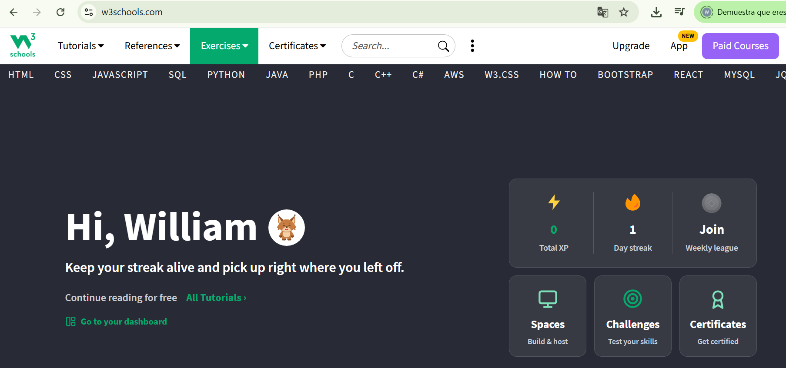

## 2. Unidad 1: Modelado dimensional

El modelado dimensional es una técnica de diseño de bases de datos
orientada al análisis y la inteligencia de negocios. Su objetivo es
organizar los datos de la forma en que el negocio los entiende,
facilitando consultas rápidas y comprensibles.

### 2.1. Hechos y dimensiones

-   **Hechos** → Representan lo que se mide (ventas, ingresos, costos).

-   **Dimensiones** → Representan las perspectivas desde las cuales se
    analizan los hechos (tiempo, producto, cliente, región).

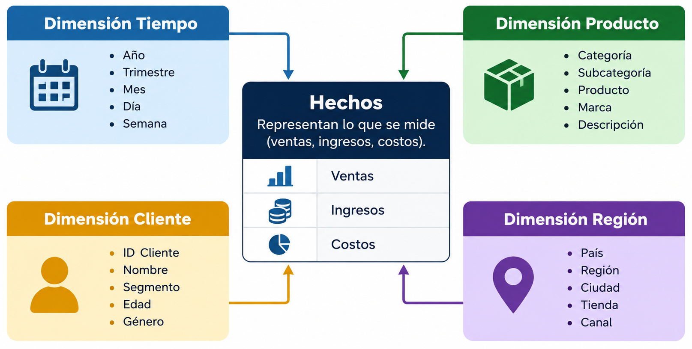

**Ejemplo de Balance Aseguradoras**

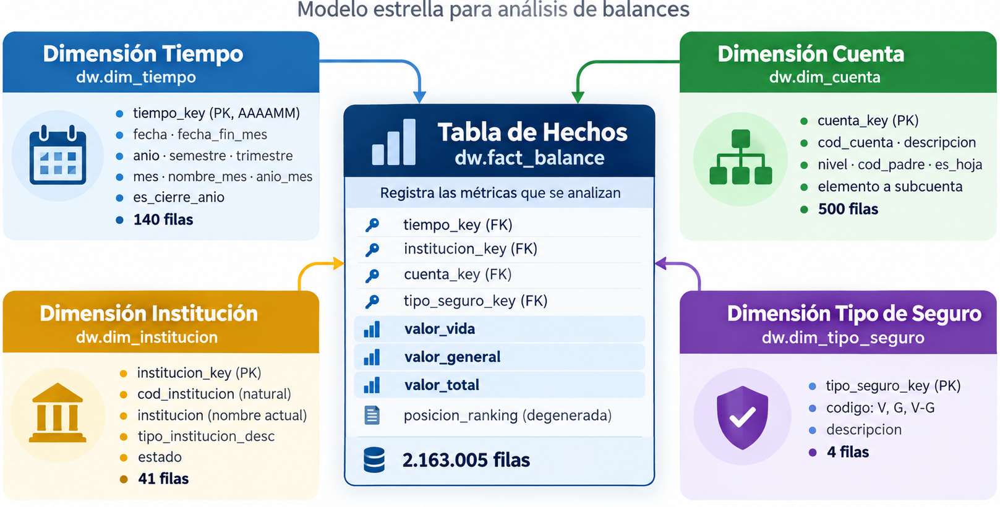

### Práctica

-   **Requisitos:**

1.  Tener Instalado PostgreSQL

2.  Tener Instalado DBeaver

**Bases de datos**

Utilizaremos la base de datos de Superintendencia de Bancos- Balances
Financieros.

-   [Descargar
    Base](https://drive.google.com/file/d/1niIyI8eDfvlhB-G_03LIMfW0XZBV-vJp/view?usp=sharing)

-   **Abrimos DBeaver**

-   Hacemos clic en Nueva conexión de base de datos

    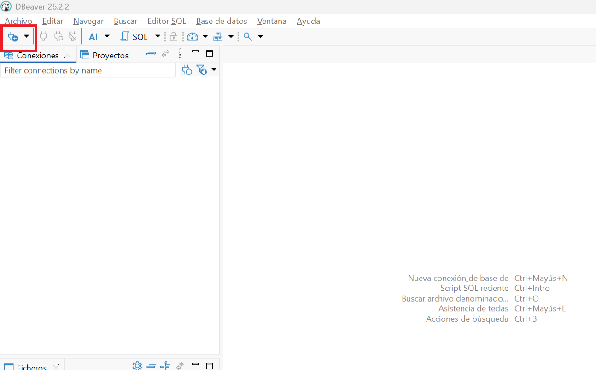

-   Seleccionamos PostgreSQL

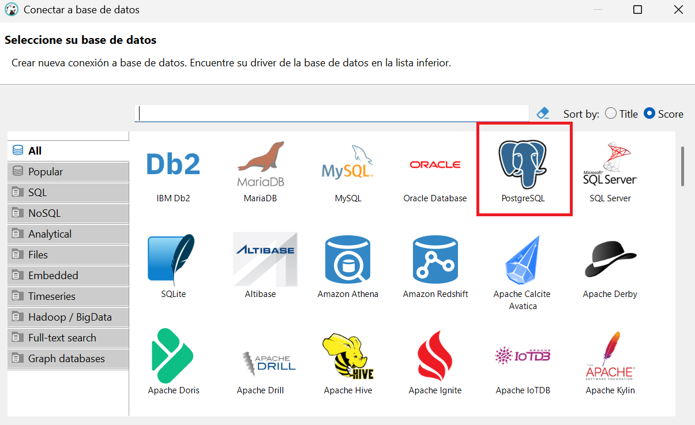

-   Seleccionamos Driver Standard y clic en continuar.

    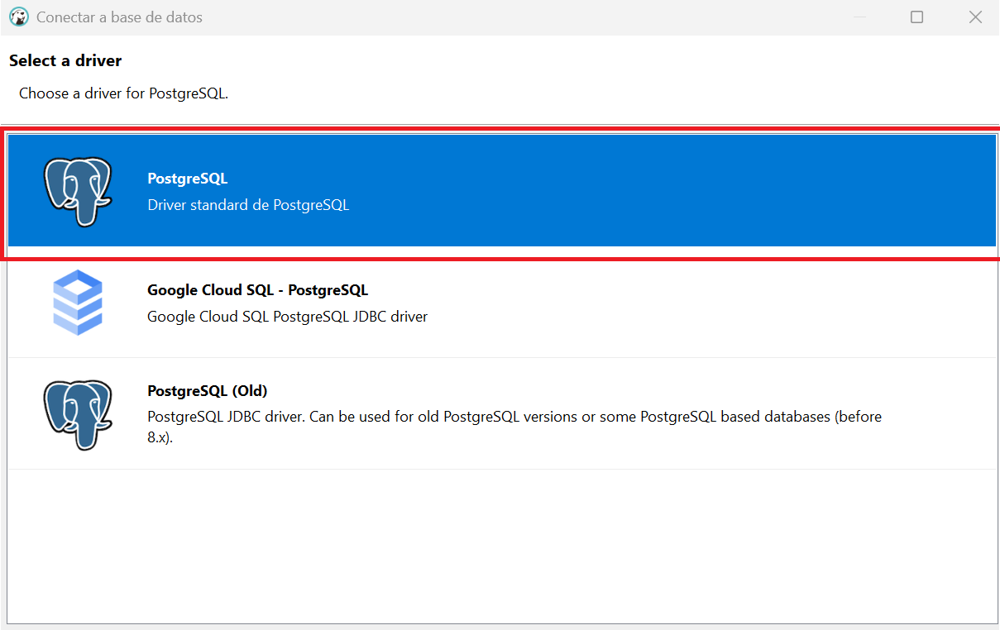

-   Damos clic en Show all databses y colocamos la clave que utilizamos
    al instalar

-   Clic en Finalizar

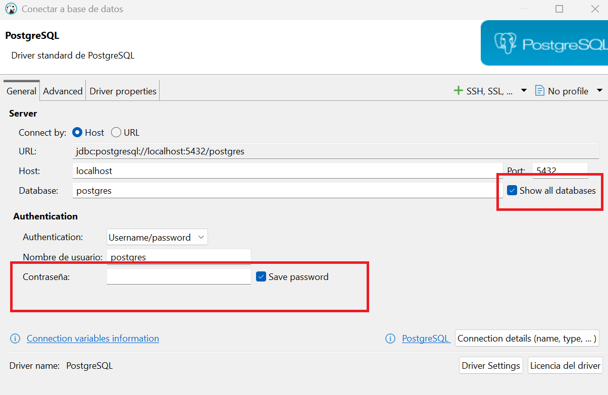

-   Verificamos que la conexión se haya realizado

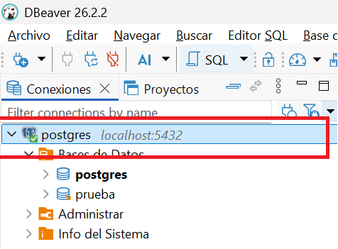

**Vamos con nuestro primer comando...**

-   Hacer clic derecho sobre postgres (Figura del Elefante), Editor SQL,
    Script SQL

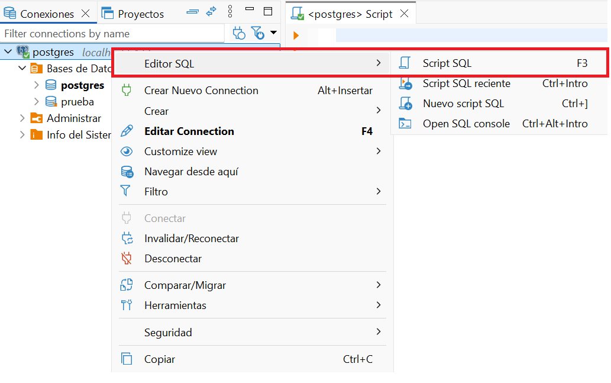

**Dentro del Script escribimos lo siguinte:**

1.  **Creamos la base de datos bi_seguros**

``` sql
CREATE DATABASE bi_seguros;
```

\*Debemos crear las tablas en la base correcta.

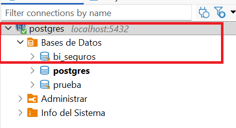

2.  **Creamos los esquemas**

    Vamos a organizar la base en tres esquemas, que son como carpetas:
    `staging` para los datos crudos tal como llegan, `dw` para el modelo
    limpio que usará Power BI, y `kpi` para los indicadores.

    Esta separación por capas es la que vieron en el Módulo 2.

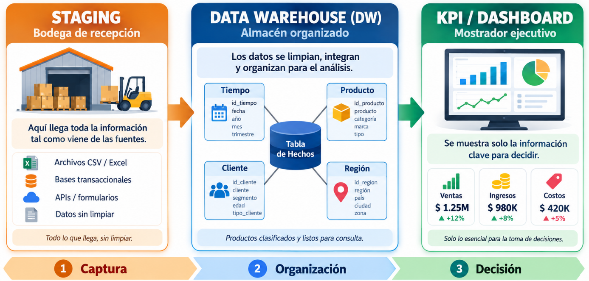

**Por qué utilizamos esquemas? tiene alguna lógica?...**

-   **Organización lógica:** Los esquemas funcionan como “carpetas”
    dentro de la base. Permiten separar las tablas según el área de
    negocio (cartera, depósitos, balances) o según la capa de
    procesamiento (staging, dw, kpi).

-   **Seguridad y control de acceso:** Puedes dar permisos distintos por
    esquema.

    Ejemplo: El área de riesgos accede solo al esquema *cartera*,
    mientras que contabilidad accede a *balances*.

-   **Mantenibilidad:** Si mañana necesitas modificar el modelo de
    *depósitos*, no afectas directamente las tablas de *cartera*. Cada
    esquema evoluciona de manera más independiente.

-   **Escalabilidad:** En bancos y aseguradoras, los datos suelen crecer
    mucho. Separar por esquemas evita que todo quede mezclado en un
    único espacio y facilita la administración.

-   **Claridad para los usuarios:** Cuando un analista abre la base y ve
    `cartera.clientes`,
    `depositos.transacciones`,`balances.estado_resultados`, entiende
    inmediatamente de qué área provienen los datos.

### Comparación de enfoques

| Enfoque | Ventajas | Desventajas |
|------------------------|------------------------|------------------------|
| **Un solo esquema con todas las tablas** | Simplicidad inicial, menos configuración | Se vuelve caótico en bases grandes, difícil de dar permisos granulares |
| **Varios esquemas por área de negocio (cartera, depósitos, balances)** | Organización clara, seguridad por área, facilita auditoría | Puede haber redundancia si no se define bien la relación entre áreas |
| **Varios esquemas por capa (staging, dw, kpi)** | Orden en el flujo de datos, separación técnica, facilita BI | Requiere disciplina en ETL y gobernanza |

Crear esquemas es recomendable porque aporta orden, seguridad y
claridad, especialmente en organizaciones grandes como bancos o
aseguradoras. La decisión de si dividir por área de negocio (cartera,
depósitos, balances) o por capa técnica (staging, dw, kpi) depende del
objetivo:

-   Si buscas gobernanza y permisos, conviene por área.

-   Si buscas flujo analítico limpio, conviene por capas.

3.  **Creación de esquemas y tabla de staging**

``` sql
CREATE SCHEMA IF NOT EXISTS staging;
CREATE SCHEMA IF NOT EXISTS dw;
CREATE SCHEMA IF NOT EXISTS kpi;

CREATE TABLE IF NOT EXISTS staging.reportes_raw (
    cod_cuenta         TEXT,
    descripcion_cuenta TEXT,
    institucion        TEXT,
    valor_vida         TEXT,
    valor_general      TEXT,
    mes                TEXT,
    anio               TEXT,
    tipo_seguro        TEXT,
    tipo_registro      TEXT,
    cod_institucion    TEXT,
    tipo_institucion   TEXT,
    valor_total        TEXT,
    posicion_ranking   TEXT
);
```

-   Organiza la base en tres esquemas (staging, dw, kpi).

-   Limpia la tabla `reportes_raw` si ya existía.

-   Crea una nueva tabla `reportes_raw` en el esquema `staging` para
    recibir datos crudos.

**Por qué cargar todo como TEXT?**

Se carga como texto en staging para no perder nada y garantizar que todo
entra, y luego en el DW se hace la limpieza y tipado correcto.

4.  **Verificamos la carga**

``` sql
SELECT COUNT(*) AS filas FROM staging.reportes_raw;
```

El archivo tiene 3.004.600 líneas; la primera es el encabezado y no se
carga; por lo que vemos 3.004.599,

5.  **Medimos el universo**

``` sql
SELECT COUNT(DISTINCT cod_institucion)     AS aseguradoras,
       COUNT(DISTINCT institucion)         AS nombres_distintos,
       COUNT(DISTINCT cod_cuenta)          AS cuentas,
       COUNT(DISTINCT anio || '-' || mes)  AS periodos,
       MIN(anio || '-' || mes)             AS desde,
       MAX(anio || '-' || mes)             AS hasta
FROM staging.reportes_raw;
```

"Hay 40 códigos de aseguradora pero 49 nombres. ¿Cómo puede ser?"

6.  **Conocer las columnas de categoría**

``` sql
SELECT tipo_registro, COUNT(*) AS filas, COUNT(DISTINCT cod_cuenta) AS cuentas
FROM staging.reportes_raw GROUP BY 1 ORDER BY 1;
```

B con 2.163.005 filas y 499 cuentas; R con 841.594 filas y 167 cuentas.
B son las cuentas del balance contable: activo, pasivo, patrimonio,
ingresos, egresos. R son registros complementarios: indicadores ya
calculados (por ejemplo 46-53, siniestros menos recuperaciones) y anexos
con códigos como SEGN005. Para el modelo usaremos B, que es la
contabilidad oficial.

``` sql
SELECT tipo_seguro, tipo_institucion, COUNT(DISTINCT cod_institucion) AS aseguradoras, COUNT(*) AS filas
FROM staging.reportes_raw GROUP BY 1, 2 ORDER BY 1, 2;
```

`tipo_seguro` dice qué ramos opera la aseguradora: solo Vida, solo
Generales o ambos. `tipo_institucion` distingue el tipo de entidad: 15
son las compañías de seguros nacionales, 16 aparece en sucursales de
compañías extranjeras (Pan American Life Insurance Company, Coface) y 17
en reaseguradoras (Reaseguradora del Ecuador, Universal)

7.  **Una aseguradora con varios nombres**

``` sql
SELECT cod_institucion, string_agg(DISTINCT institucion, ' | ') AS nombres
FROM staging.reportes_raw
GROUP BY cod_institucion
HAVING COUNT(DISTINCT institucion) > 1;
```

Las empresas cambian de nombre, se fusionan o entran en liquidación. Si
usáramos el nombre como identificador, Liberty y Atlántida parecerían
dos empresas distintas y su historia se partiría en dos. Por eso la
clave de una aseguradora es su código, no su nombre.

8.  **Verificamos que los números son números**

``` sql
SELECT COUNT(*) AS valores_invalidos
FROM staging.reportes_raw
WHERE valor_total   !~ '^-?[0-9]+(\.[0-9]+)?$'
   OR valor_vida    !~ '^-?[0-9]+(\.[0-9]+)?$'
   OR valor_general !~ '^-?[0-9]+(\.[0-9]+)?$';
```

-   !\~: operador de PostgreSQL que significa “no coincide con la
    expresión regular”.

-   Regex \^-?\[0-9\]+(.\[0-9\]+)?\$: valida números enteros o
    decimales, positivos o negativos.

-   La consulta cuenta todas las filas donde alguna de las tres columnas
    (valor_total, valor_vida, valor_general) no es un número válido

-   Si el conteo devuelve un número mayor a 0, significa que tienes
    registros con problemas de calidad (vacíos, texto, símbolos,
    formatos incorrectos).

-   Si devuelve 0, significa que todos los valores cumplen el patrón
    numérico.

9.  **Inspeccionamos cuales son esos valores inválidos**

``` sql
SELECT cod_institucion,
       valor_total,
       valor_vida,
       valor_general
FROM staging.reportes_raw
WHERE valor_total   !~ '^-?[0-9]+(\.[0-9]+)?$'
   OR valor_vida    !~ '^-?[0-9]+(\.[0-9]+)?$'
   OR valor_general !~ '^-?[0-9]+(\.[0-9]+)?$'
LIMIT 50;
```

\*Podemos verificar donde estan los errores

``` sql
--Verificamos cuantos errores hay en columnas 

SELECT
    COUNT(*) FILTER (
        WHERE valor_total !~ '^-?[0-9]+(\.[0-9]+)?$'
    ) AS invalidos_total,

    COUNT(*) FILTER (
        WHERE valor_vida !~ '^-?[0-9]+(\.[0-9]+)?$'
    ) AS invalidos_vida,

    COUNT(*) FILTER (
        WHERE valor_general !~ '^-?[0-9]+(\.[0-9]+)?$'
    ) AS invalidos_general

FROM staging.reportes_raw;
```

Podemos limpiar esos errores

``` sql
UPDATE staging.reportes_raw
SET valor_general = NULL
WHERE TRIM(valor_general) = '';

UPDATE staging.reportes_raw
SET valor_vida = NULL
WHERE TRIM(valor_vida) = '';

UPDATE staging.reportes_raw
SET valor_total = NULL
WHERE TRIM(valor_total) = '';
```

10. **Buscamos filas repetidas**

``` sql
SELECT COUNT(*) AS filas_totales,
       (SELECT COUNT(*) FROM (SELECT DISTINCT * FROM staging.reportes_raw) d) AS filas_unicas
FROM staging.reportes_raw;
```

3.004.599 filas totales y 2.598.345 únicas. Es decir, 406.254 filas son
copias exactas de otras. Esta consulta tarda unos segundos: está
comparando 3 millones de filas.

``` sql
SELECT tipo_registro, cod_cuenta,
       COUNT(*) - COUNT(DISTINCT (cod_institucion, anio, mes)) AS sobrantes
FROM staging.reportes_raw
GROUP BY 1, 2
HAVING COUNT(*) > COUNT(DISTINCT (cod_institucion, anio, mes))
ORDER BY sobrantes DESC
LIMIT 10;
```

Si hubiéramos sumado sin revisar, cualquier indicador basado en SEGN005
estaría inflado cientos de veces. Y miren: el balance (B) no tiene ni
una repetida. Otra razón para construir el modelo sobre B.

11. **Verifiquemos si el total es correcto.**

``` sql
SELECT tipo_registro,
       SUM(CASE WHEN abs(valor_total::NUMERIC - (valor_vida::NUMERIC + valor_general::NUMERIC)) > 1
                THEN 1 ELSE 0 END) AS filas_descuadradas
FROM staging.reportes_raw
GROUP BY 1;
```

En el balance, Total siempre es Vida más Generales. En R no, porque
muchos registros R son razones o porcentajes, y una razón no se suma.

12. **Creamos una tabla limpia**

``` sql
DROP TABLE IF EXISTS staging.reportes CASCADE;
CREATE TABLE staging.reportes AS
SELECT DISTINCT
    btrim(cod_cuenta)                                   AS cod_cuenta,
    NULLIF(btrim(descripcion_cuenta), '')               AS descripcion_cuenta,
    upper(btrim(institucion))                           AS institucion,
    btrim(cod_institucion)::INTEGER                     AS cod_institucion,
    btrim(tipo_institucion)::SMALLINT                   AS tipo_institucion,
    btrim(tipo_seguro)                                  AS tipo_seguro,
    btrim(tipo_registro)                                AS tipo_registro,
    btrim(anio)::SMALLINT                               AS anio,
    btrim(mes)::SMALLINT                                AS mes,
    valor_vida::NUMERIC(20,2)                           AS valor_vida,
    valor_general::NUMERIC(20,2)                        AS valor_general,
    valor_total::NUMERIC(20,2)                          AS valor_total,
    NULLIF(btrim(posicion_ranking), '0')::INTEGER       AS posicion_ranking
FROM staging.reportes_raw;

ANALYZE staging.reportes;

-- Controles
SELECT tipo_registro, COUNT(*) AS filas FROM staging.reportes GROUP BY 1;

SELECT COUNT(*) AS filas_b,
       COUNT(DISTINCT (cod_institucion, cod_cuenta, anio, mes)) AS combinaciones_unicas_b
FROM staging.reportes
WHERE tipo_registro = 'B';
```

Toda pregunta de negocio tiene dos partes:

-   Qué medimos y por qué lo cortamos.

-   '¿Cuánta prima emitió cada aseguradora en 2025?' mide prima (un
    número que se suma) y la corta por aseguradora y por año.

-   Lo que se mide se llama hecho o medida; lo que sirve para cortar,
    filtrar o agrupar se llama dimensión. La prueba rápida es
    preguntarse de cada columna: ¿la sumo o la uso para filtrar?

Veamos con nuestra base..

| **Columna** | **¿Se suma o se filtra?** | **Va a…** |
|------------------------|------------------------|------------------------|
| valor_vida, valor_general, valor_total |  | Medidas del hecho |
| cod_institucion, institucion, tipo_institucion |  |  |
| cod_cuenta, descripcion_cuenta |  |  |
| anio, mes |  |  |
| tipo_seguro |  |  |
| posicion_ranking |  |  |
| tipo_registro | Se usa para elegir filas | No va al modelo (solo cargamos B) |

**¿Por qué no sumamos `posicion_ranking`?**

1.  Contar los miembros de cada dimensión.

``` sql
SELECT 'aseguradora' AS atributo, COUNT(DISTINCT cod_institucion) AS miembros FROM staging.reportes WHERE tipo_registro = 'B'
UNION ALL SELECT 'cuenta',      COUNT(DISTINCT cod_cuenta)    FROM staging.reportes WHERE tipo_registro = 'B'
UNION ALL SELECT 'periodo',     COUNT(DISTINCT (anio, mes))   FROM staging.reportes WHERE tipo_registro = 'B'
UNION ALL SELECT 'tipo_seguro', COUNT(DISTINCT tipo_seguro)   FROM staging.reportes WHERE tipo_registro = 'B';
```

Qué deben ver: 40 aseguradoras, 499 cuentas, 140 periodos y 3 tipos de
seguro.

Fíjense en la diferencia de tamaños: las dimensiones son pequeñas (40,
499, 140, 3) y el hecho es enorme (2,1 millones). Así es casi siempre:
pocas cosas que describen, muchísimas mediciones.

### 2.2. Jerarquías

Una jerarquía es una ruta de resumen dentro de una dimensión, que va de
lo general a lo particular. Permite navegar los datos en dos
direcciones:

-   **Roll-up:** Subir de nivel (ej. de mes a trimestre, de trimestre a
    año).

-   **Drill-down:** bajar al detalle (ej. de año a trimestre, de
    trimestre a mes, de mes a día).

Las jerarquías son esenciales en BI porque permiten analizar la misma
métrica en distintos niveles de agregación.

**Conceptos clave**

-   **Jerarquía balanceada:** Todas las ramas tienen la misma
    profundidad.

    Ejemplo: Tiempo → Año → Trimestre → Mes → Día.

-   **Jerarquía irregular (ragged):** Las ramas terminan en niveles
    distintos.

    Ejemplo: Un plan de cuentas contable, donde algunas cuentas llegan
    hasta nivel 5 y otras solo hasta nivel 3.

-   **Jerarquía padre-hijo:** Cada miembro conoce a su padre mediante un
    campo como `cod_padre`.

    Ejemplo: estructura organizacional (Gerente → Jefe → Analista).

-   **Aplanar una jerarquía:** Guardar una columna por nivel (ej.
    `nivel1`, `nivel2`, `nivel3`) para que las herramientas de BI puedan
    recorrerla fácilmente.

-   **Riesgo de doble conteo:** Si los datos existen en varios niveles,
    sumar niveles distintos puede duplicar valores.

    Ejemplo: sumar ventas por categoría y por producto sin cuidado puede
    inflar el resultado.

**Con nuestra base**

En el caso de códigos contables, el código crece dos dígitos por nivel:

-   Nivel 1: `1` → Activos.

-   Nivel 2: `11` → Activos corrientes.

-   Nivel 3: `1101` → Caja y bancos.

Esto refleja una jerarquía padre-hijo, donde cada nivel se construye
concatenando el código del nivel superior.

**✅ Conclusión**

Las jerarquías permiten que los usuarios naveguen los datos de manera
intuitiva, desde un resumen global hasta el detalle más específico.

-   Son fundamentales para el análisis en BI.

-   Deben diseñarse con cuidado para evitar doble conteo y asegurar que
    las herramientas de análisis (como Power BI) las interpreten
    correctamente.

``` sql
SELECT length(cod_cuenta) AS digitos,
       COUNT(DISTINCT cod_cuenta) AS cuentas,
       MIN(cod_cuenta) AS ejemplo
FROM staging.reportes
WHERE tipo_registro = 'B'
GROUP BY 1 ORDER BY 1;  
```

-   Aquí podemos identificar

-   Elementos Grupo Cuenta Subcuenta Auxiliar

-   Podemos trabajar con códigos

``` sql
SELECT DISTINCT cod_cuenta, descripcion_cuenta, length(cod_cuenta) AS digitos
FROM staging.reportes
WHERE tipo_registro = 'B'
  AND cod_cuenta IN ('1', '11', '1101', '110101', '11010101')
ORDER BY cod_cuenta;
```

Cada nivel es la suma de sus hijos.

Comprobémoslo con números en un momento. La consecuencia práctica es
enorme: si sumamos la cuenta 1 y la cuenta 11, contamos las inversiones
dos veces.

En el modelo tendremos que saber siempre en qué nivel estamos.

**Tenemos padres completos**

``` sql
WITH c AS (SELECT DISTINCT cod_cuenta FROM staging.reportes WHERE tipo_registro = 'B')
SELECT h.cod_cuenta
FROM c h
WHERE length(h.cod_cuenta) > 1
  AND NOT EXISTS (SELECT 1 FROM c p
                  WHERE p.cod_cuenta = CASE WHEN length(h.cod_cuenta) = 2 THEN left(h.cod_cuenta, 1)
                                            ELSE left(h.cod_cuenta, length(h.cod_cuenta) - 2) END);
```

**Validamos jerarquías**

Las tres jerarquías del modelo:

-   Cuenta: elemento → grupo → cuenta → subcuenta → auxiliar.

-   Tiempo: año → semestre → trimestre → mes.

-   Institución: tipo de institución (compañía, sucursal extranjera,
    reaseguradora) → aseguradora.

### 2.3. Granularidad

El grano es el nivel de detalle de una fila en la tabla de hechos. Antes
de elegir dimensiones y medidas, se debe declarar el grano en una frase.
Todas las medidas deben estar en ese mismo grano para evitar
inconsistencias.

**Grano atómico:**

-   Es el máximo detalle disponible.

-   Permite responder preguntas que todavía no se han planteado.

-   Ejemplo: cada transacción individual en un banco.

**Declaración del grano:**

-   Se expresa como: *“una fila representa…”*.

-   Ejemplo: *“una fila representa una venta de un producto a un cliente
    en una fecha determinada”*.

-   Si dos filas tienen la misma combinación de claves, el grano está
    mal declarado o hay duplicados,

**Tipos de tabla de hechos según el grano:**

-   **Transaccional:** un evento por fila (ej. cada compra, cada pago).

-   **Instantánea periódica:** una foto por periodo (ej. saldos
    mensuales de cuentas).

-   **Instantánea acumulativa:** un proceso con varias fechas (ej.
    evolución de un préstamo desde inicio hasta fin).

-   **Mezclar granos:**

    -   Ejemplo: datos mensuales y anuales en la misma tabla.

    -   Produce totales incorrectos porque se suman niveles distintos.

En el caso de **aseguradoras**:

-   **Declaración del grano:** *“una fila representa una cuenta de una
    aseguradora en un mes”*.

-   Esto corresponde a una instantánea periódica mensual.

-   Por eso los saldos no se deben sumar entre meses, ya que cada fila
    es una foto independiente del estado de la cuenta.

**✅ Conclusión**

La granularidad es el corazón del modelado dimensional:

-   Define el nivel de detalle de los hechos.

-   Garantiza consistencia en las medidas.

-   Evita errores de duplicación o doble conteo.

-   Permite que los KPIs reflejen correctamente la realidad del negocio.

El grano es la respuesta a: ¿qué representa una fila? Se declara antes
de diseñar nada, en una frase. La nuestra será:

Una fila = el valor de una cuenta contable, reportado por una
aseguradora, en un mes.

**Comprobemos el grano**

``` sql
SELECT COUNT(*) AS filas,
       COUNT(DISTINCT (cod_institucion, cod_cuenta, anio, mes)) AS combinaciones_unicas
FROM staging.reportes
WHERE tipo_registro = 'B';
```

2.163.005 y 2.163.005.

Si fueran distintos, la frase del grano estaría mal: faltaría algo que
distingue a dos filas.

Ahora la pregunta más importante del módulo: ¿Todas las medidas se
pueden sumar en cualquier dirección?

``` sql
SELECT mes,
       ROUND(SUM(valor_total) FILTER (WHERE cod_cuenta = '1')  / 1e6, 1) AS activo_millones,
       ROUND(SUM(valor_total) FILTER (WHERE cod_cuenta = '51') / 1e6, 1) AS prima_emitida_millones
FROM staging.reportes
WHERE tipo_registro = 'B' AND anio = 2025
GROUP BY mes
ORDER BY mes;
```

El activo se mantiene alrededor de 2.700 millones: es un saldo, una foto
del día. La prima crece mes a mes: es un acumulado del año, enero más
febrero más marzo… ¿Qué pasa si sumamos los 12 meses del activo? Nos
daría 32.000 millones: un número que no existe. ¿Y si sumamos los 12
meses de la prima? Contaríamos enero doce veces.

**✅ Conclusión**:

Valor_total es una medida semiaditiva. Se puede sumar entre aseguradoras
(el activo del sistema es la suma de los activos de cada una) pero en el
tiempo no se suma: se toma el último mes del periodo. El total de 2025
es el valor de diciembre; el de 2026 hasta hoy es el de agosto.

Cuadre de cuentas

``` sql
SELECT ROUND(SUM(valor_total) FILTER (WHERE cod_cuenta = '1') / 1e6, 1) AS activo,
       ROUND(SUM(valor_total) FILTER (WHERE cod_cuenta = '2') / 1e6, 1) AS pasivo,
       ROUND(SUM(valor_total) FILTER (WHERE cod_cuenta = '3') / 1e6, 1) AS patrimonio
FROM staging.reportes
WHERE tipo_registro = 'B' AND anio = 2025 AND mes = 12;
```

La contabilidad cuadra, los datos son confiables.

### 2.3. Modelos Analíticos

Los sistemas que **registran operaciones (OLTP)** y los que **analizan
información (OLAP)** tienen necesidades opuestas, y por eso se modelan
distinto:

-   **OLTP:** optimizado para escribir rápido y mantener integridad.

-   **OLAP:** optimizado para leer rápido y facilitar análisis.

**🔑 Conceptos clave**

-   **OLTP (Online Transaction Processing):**

    -   Muchas transacciones pequeñas.

    -   Modelo **normalizado (3FN)** para evitar redundancia.

    -   Prioriza la **integridad al escribir**.

    -   Ejemplo: sistema bancario que registra cada pago o
        transferencia.

-   **OLAP (Online Analytical Processing):**

    -   Pocas consultas grandes de lectura.

    -   Modelo **dimensional** (estrella, copo de nieve).

    -   Prioriza la **velocidad al leer**.

    -   Ejemplo: dashboard de ventas que calcula KPIs por región y
        producto.

🏛 **Enfoques de Data Warehouse**

-   **Inmon:** almacén corporativo normalizado → de ahí salen *data
    marts* temáticos.

-   **Kimball:** *data marts* dimensionales integrados por **dimensiones
    conformadas** (comparten las mismas definiciones de cliente,
    producto, tiempo).

👉 ***En la práctica, Kimball es más usado en BI porque es más directo
para análisis.***

**📐 Formas del modelo**

-   **Tabla plana:** todos los datos en una sola tabla (simple pero poco
    eficiente).

-   **Estrella (Star Schema):** tabla de hechos central + dimensiones
    desnormalizadas.

-   **Copo de nieve (Snowflake):** dimensiones normalizadas en varias
    tablas.

-   **Constelación:** varias tablas de hechos que comparten dimensiones
    (ej. ventas y devoluciones).

🔄 **Dimensiones lentamente cambiantes (SCD)**

Las dimensiones cambian con el tiempo (ej. nombre de cliente,
dirección).

-   **Tipo 1:** sobrescribe el valor (no guarda historia).

-   **Tipo 2:** guarda una fila por versión (histórico completo).

-   **Tipo 3:** guarda el valor anterior en otra columna (historia
    limitada).

📊 **Con nuestra base**

-   El CSV inicial es una tabla plana.

-   Lo transformamos en un modelo estrella para análisis.

-   Los nombres cambiantes de las aseguradoras se resuelven con SCD tipo
    1 (sobrescribir valor).

✅ Conclusión

-   OLTP y OLAP son complementarios: uno registra operaciones, el otro
    analiza.

-   El modelo estrella es la base del BI porque simplifica y acelera las
    consultas.

-   Los enfoques de Inmon y Kimball ofrecen estrategias distintas, pero
    ambos buscan integrar la información.

-   Las dimensiones lentamente cambiantes son clave para manejar la
    evolución de los datos en el tiempo.

**En nuestro ejemplo:**

Qué nombre ponemos a la aseguradora 1107: HDI, Liberty o Atlántida? Hay
dos escuelas. Tipo 1: guardamos solo el nombre más reciente y toda la
historia aparece como Atlántida. Tipo 2: guardamos una fila por cada
nombre con fechas de vigencia.

Para un ranking del sistema, el tipo 1 es suficiente y es lo que
haremos. A esto se le llama dimensión lentamente cambiante (SCD).

### 2.4 Casos prácticos

📌 **Idea central**

Todo diseño dimensional sigue los **cuatro pasos de Kimball**:

1.  **Elegir el proceso de negocio** → seleccionar una actividad que
    genera mediciones.

2.  **Declarar el grano** → definir el nivel de detalle de la tabla de
    hechos.

3.  **Identificar las dimensiones** → establecer las perspectivas de
    análisis.

4.  **Identificar los hechos** → definir las métricas que se van a
    medir.

👉 Estos pasos aseguran que el modelo refleje la lógica del negocio y
sea útil para análisis.

**🔑 Conceptos clave**

-   **Proceso de negocio:** Es la actividad que genera datos medibles.
    Ejemplos: vender productos, pagar siniestros, reportar balances.

-   **Matriz de bus:** Es una tabla que organiza los procesos (filas)
    frente a las dimensiones (columnas). Sirve para planificar todo el
    almacén de datos y asegurar consistencia.

-   **Dimensión conformada:** Es una dimensión compartida por varios
    procesos, lo que permite cruzar información. Ejemplo: la dimensión
    *Tiempo* usada tanto en ventas como en balances.

📊 **Con nuestra base**

-   **Proceso:** reporte mensual del balance de las aseguradoras a la
    Superintendencia de Compañías.

-   **Grano:** una fila representa *una cuenta de una aseguradora en un
    mes*.

-   **Dimensiones:** aseguradora, tiempo, tipo de cuenta, región.

-   **Hechos:** saldos, ingresos, egresos, patrimonio.

👉 Este caso corresponde a una instantánea periódica mensual, donde cada
fila es una foto del estado financiero de la aseguradora en un periodo.

**✅ Conclusión**

Los casos prácticos permiten aplicar la teoría del modelado dimensional
a situaciones reales:

-   Se parte de un proceso de negocio claro.

-   Se declara el grano para evitar duplicados.

-   Se identifican dimensiones y hechos para estructurar el análisis.

-   Se construye una matriz de bus que asegura que los distintos
    procesos compartan dimensiones conformadas.

## 3. Unidad 2: Esquema Estrella

### 3.1 Star Schema

Diseñar esquemas estrella para mejorar el rendimiento en consultas. Al
final de la sesión existe el esquema dw con cuatro dimensiones y la
tabla de hechos fact_balance, cuadrada al centavo con staging.

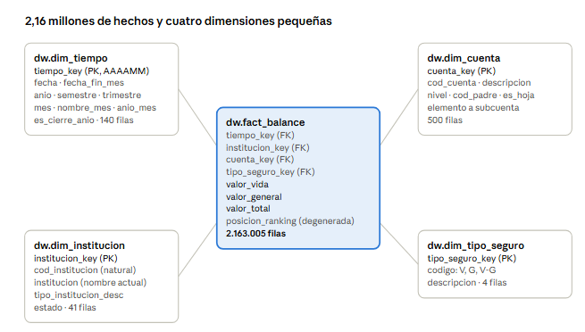

**Vamos a crear las tablas**

``` sql
CREATE TABLE dw.dim_tiempo (
    tiempo_key SERIAL PRIMARY KEY,
    anio       INTEGER NOT NULL,
    mes        INTEGER NOT NULL
);

CREATE TABLE dw.dim_institucion (
    institucion_key SERIAL PRIMARY KEY,
    cod_institucion TEXT NOT NULL,
    institucion     TEXT,
    tipo_institucion TEXT
);

CREATE TABLE dw.dim_cuenta (
    cuenta_key SERIAL PRIMARY KEY,
    cod_cuenta TEXT NOT NULL,
    descripcion_cuenta TEXT
);

CREATE TABLE dw.dim_tipo_seguro (
    tipo_seguro_key SERIAL PRIMARY KEY,
    tipo_seguro TEXT NOT NULL
);
```

### 3.2 Tabla de hechos

``` sql
CREATE TABLE dw.fact_balance (
    tiempo_key        INTEGER NOT NULL REFERENCES dw.dim_tiempo (tiempo_key),
    institucion_key   INTEGER NOT NULL REFERENCES dw.dim_institucion (institucion_key),
    cuenta_key        INTEGER NOT NULL REFERENCES dw.dim_cuenta (cuenta_key),
    tipo_seguro_key   INTEGER NOT NULL REFERENCES dw.dim_tipo_seguro (tipo_seguro_key),
    valor_vida        NUMERIC(20,2) NOT NULL,
    valor_general     NUMERIC(20,2) NOT NULL,
    valor_total       NUMERIC(20,2) NOT NULL,
    posicion_ranking  INTEGER, -- dimensión degenerada
    PRIMARY KEY (tiempo_key, institucion_key, cuenta_key)
);
```

**Este es un excelente ejemplo:**

-   Orden de creación importa → primero las dimensiones, luego la tabla
    de hechos.

-   Llaves foráneas aseguran integridad → no puedes cargar un hecho si
    no existe la dimensión correspondiente.

-   Modelo estrella → las dimensiones describen el hecho, y el hecho
    guarda las medidas.

**Un paso adicional**

Limpiar (por si se repite la sesión):

``` sql
DROP TABLE IF EXISTS dw.fact_balance CASCADE;
DROP TABLE IF EXISTS dw.dim_tiempo, dw.dim_institucion, dw.dim_cuenta, dw.dim_tipo_seguro CASCADE;
```

### 3.3 Tabla de dimensiones

**Vamos a crear la dimensión tiempo**

La dimensión Tiempo no se copia de los datos: se genera con todos los
meses desde el primero hasta el último, sin huecos. generate_series crea
una fila por mes.

Si un mes faltara en los datos, igual existiría en el calendario, y eso
nos permitirá detectar meses sin reporte

``` sql
CREATE TABLE dw.dim_tiempo (
    tiempo_key      INTEGER PRIMARY KEY,          -- AAAAMM, ej. 202608
    fecha           DATE NOT NULL UNIQUE,         -- primer día del mes
    fecha_fin_mes   DATE NOT NULL,
    anio            SMALLINT NOT NULL,
    semestre        SMALLINT NOT NULL,
    trimestre       SMALLINT NOT NULL,
    mes             SMALLINT NOT NULL,
    nombre_mes      VARCHAR(12) NOT NULL,
    anio_mes        CHAR(7) NOT NULL,             -- '2026-08'
    es_cierre_anio  BOOLEAN NOT NULL
);
INSERT INTO dw.dim_tiempo
SELECT  to_char(f, 'YYYYMM')::INTEGER,
        f::DATE,
        (f + INTERVAL '1 month - 1 day')::DATE,
        EXTRACT(YEAR FROM f),
        CASE WHEN EXTRACT(MONTH FROM f) <= 6 THEN 1 ELSE 2 END,
        EXTRACT(QUARTER FROM f),
        EXTRACT(MONTH FROM f),
        (ARRAY['Enero','Febrero','Marzo','Abril','Mayo','Junio','Julio',
               'Agosto','Septiembre','Octubre','Noviembre','Diciembre'])[EXTRACT(MONTH FROM f)::INT],
        to_char(f, 'YYYY-MM'),
        EXTRACT(MONTH FROM f) = 12
FROM generate_series(
        (SELECT make_date(MIN(anio), 1, 1) FROM staging.reportes),
        (SELECT make_date(MAX(anio), MAX(mes) FILTER (WHERE anio = (SELECT MAX(anio) FROM staging.reportes)), 1)
         FROM staging.reportes),
        INTERVAL '1 month') AS f;

SELECT * FROM dw.dim_tiempo ORDER BY tiempo_key DESC LIMIT 3;
```

**Creamos la dimensión institución**

Aquí aplicamos lo que descubrimos: la clave natural es cod_institucion y
el nombre que mostramos es el más reciente (SCD tipo 1). DISTINCT ON
toma, para cada código, la primera fila según el orden indicado: la del
año y mes más altos.

Además guardamos todos los nombres históricos en una columna, para no
perder la información, y calculamos si la aseguradora sigue activa.

``` sql
CREATE TABLE dw.dim_institucion (
    institucion_key     INTEGER GENERATED BY DEFAULT AS IDENTITY PRIMARY KEY,
    cod_institucion     INTEGER NOT NULL UNIQUE,
    institucion         VARCHAR(200) NOT NULL,       -- nombre más reciente
    nombres_historicos  TEXT,
    tipo_institucion    SMALLINT,
    tipo_institucion_desc VARCHAR(60),
    primer_periodo      INTEGER,
    ultimo_periodo      INTEGER,
    estado              VARCHAR(30)
);
INSERT INTO dw.dim_institucion (institucion_key, cod_institucion, institucion, estado)
VALUES (-1, -1, 'NO IDENTIFICADA', 'N/D');

INSERT INTO dw.dim_institucion (cod_institucion, institucion, nombres_historicos, tipo_institucion,
                                tipo_institucion_desc, primer_periodo, ultimo_periodo, estado)
SELECT  r.cod_institucion,
        r.institucion,
        h.nombres,
        r.tipo_institucion,
        CASE r.tipo_institucion WHEN 15 THEN 'Compañía de seguros'
                                WHEN 16 THEN 'Sucursal de compañía extranjera'
                                WHEN 17 THEN 'Reaseguradora'
                                ELSE 'Otro' END,
        h.primer, h.ultimo,
        CASE WHEN h.ultimo = (SELECT MAX(anio * 100 + mes) FROM staging.reportes) THEN 'Activa'
             ELSE 'Sin reporte reciente' END
FROM (
    SELECT DISTINCT ON (cod_institucion) cod_institucion, institucion, tipo_institucion
    FROM staging.reportes
    WHERE tipo_registro = 'B'
    ORDER BY cod_institucion, anio DESC, mes DESC
) r
JOIN (
    SELECT cod_institucion,
           string_agg(DISTINCT institucion, ' | ') AS nombres,
           MIN(anio * 100 + mes) AS primer,
           MAX(anio * 100 + mes) AS ultimo
    FROM staging.reportes
    WHERE tipo_registro = 'B'
    GROUP BY cod_institucion
) h USING (cod_institucion)
ORDER BY r.cod_institucion;

SELECT cod_institucion, institucion, estado, ultimo_periodo
FROM dw.dim_institucion
WHERE cod_institucion IN (1107, 1087, 1105);
```

-   institucion_key = -1 → clave sustituta en la dimensión.

-   cod_institucion = -1 → valor artificial que no existe en los datos
    reales.

-   institucion = 'NO IDENTIFICADA' → etiqueta que describe que no se
    conoce la institución.

-   estado = 'N/D' → “No disponible”.

✅ Para qué sirve: Es un registro comodín o default en la dimensión.

Se usa cuando en la tabla de hechos (fact_balance) aparece un dato con
institución desconocida, nula o inválida.

-   Así evitas que la llave foránea falle y mantienes la integridad
    referencial.

-   En modelos dimensionales esto se llama “surrogate key para valores
    desconocidos” o “dummy member”.

-   Supón que en tus datos de staging tienes un registro con
    cod_institucion = NULL.

-   Al cargar al DW, en lugar de romper la relación, lo asignas a
    institucion_key = -1.

-   En los reportes, aparecerá como “NO IDENTIFICADA”.

-   Esto asegura que todas las filas de hechos tienen una dimensión
    asociada, incluso si la información original estaba incompleta.

**Cuantas aseguradoras estan activas hoy**

``` sql
SELECT estado, COUNT(*) FROM dw.dim_institucion GROUP BY estado
```

**Creamos la dimensión Seguros**

``` sql
CREATE TABLE dw.dim_tipo_seguro (
    tipo_seguro_key  INTEGER GENERATED BY DEFAULT AS IDENTITY PRIMARY KEY,
    codigo           VARCHAR(5) NOT NULL UNIQUE,
    descripcion      VARCHAR(40) NOT NULL
);
INSERT INTO dw.dim_tipo_seguro (tipo_seguro_key, codigo, descripcion) VALUES (-1, 'N/D', 'No identificado');
INSERT INTO dw.dim_tipo_seguro (codigo, descripcion)
SELECT DISTINCT tipo_seguro,
       CASE tipo_seguro WHEN 'V'   THEN 'Vida'
                        WHEN 'G'   THEN 'Generales'
                        WHEN 'V-G' THEN 'Vida y Generales'
                        ELSE 'Otro' END
FROM staging.reportes
ORDER BY 1;

SELECT * FROM dw.dim_tipo_seguro;
```

**Creamos la dimension cuenta con Jerarquía**

Esta es la dimensión más interesante. Para cada cuenta calculamos su
nivel según los dígitos, su padre quitando los dos últimos dígitos y el
nombre de cada uno de sus ancestros. A esto se le llama jerarquía
aplanada: en vez de obligar a Power BI a recorrer el árbol, le damos una
columna por nivel. Es la forma que Power BI necesita para hacer drill
down.

``` sql
CREATE TABLE dw.dim_cuenta (
    cuenta_key     INTEGER GENERATED BY DEFAULT AS IDENTITY PRIMARY KEY,
    cod_cuenta     VARCHAR(10) NOT NULL UNIQUE,
    descripcion    VARCHAR(300) NOT NULL,
    nivel          SMALLINT NOT NULL,          -- 1 elemento, 2 grupo, 3 cuenta, 4 subcuenta, 5 auxiliar
    cod_padre      VARCHAR(10),
    elemento       VARCHAR(60),                -- nivel 1 (Activo, Pasivo, ...)
    grupo          VARCHAR(300),               -- nivel 2
    cuenta         VARCHAR(300),               -- nivel 3
    subcuenta      VARCHAR(300),               -- nivel 4
    estado_financiero VARCHAR(30),             -- Balance general / Estado de resultados / Orden
    es_hoja        BOOLEAN NOT NULL DEFAULT TRUE
);
INSERT INTO dw.dim_cuenta (cuenta_key, cod_cuenta, descripcion, nivel) VALUES (-1, 'N/D', 'NO IDENTIFICADA', 0);

WITH c AS (
    SELECT DISTINCT cod_cuenta, descripcion_cuenta
    FROM staging.reportes
    WHERE tipo_registro = 'B'
)
INSERT INTO dw.dim_cuenta (cod_cuenta, descripcion, nivel, cod_padre, elemento, grupo, cuenta, subcuenta, estado_financiero)
SELECT  h.cod_cuenta,
        h.descripcion_cuenta,
        CASE length(h.cod_cuenta) WHEN 1 THEN 1 WHEN 2 THEN 2 WHEN 4 THEN 3 WHEN 6 THEN 4 ELSE 5 END,
        CASE length(h.cod_cuenta) WHEN 1 THEN NULL WHEN 2 THEN left(h.cod_cuenta, 1)
             ELSE left(h.cod_cuenta, length(h.cod_cuenta) - 2) END,
        CASE left(h.cod_cuenta, 1) WHEN '1' THEN 'Activo' WHEN '2' THEN 'Pasivo' WHEN '3' THEN 'Patrimonio'
                                   WHEN '4' THEN 'Egresos' WHEN '5' THEN 'Ingresos'
                                   WHEN '6' THEN 'Contingentes' WHEN '7' THEN 'Cuentas de orden' END,
        n2.descripcion_cuenta,
        n3.descripcion_cuenta,
        n4.descripcion_cuenta,
        CASE WHEN left(h.cod_cuenta, 1) IN ('1', '2', '3') THEN 'Balance general'
             WHEN left(h.cod_cuenta, 1) IN ('4', '5')      THEN 'Estado de resultados'
             ELSE 'Contingentes y orden' END
FROM c h
LEFT JOIN c n2 ON length(h.cod_cuenta) >= 2 AND n2.cod_cuenta = left(h.cod_cuenta, 2)
LEFT JOIN c n3 ON length(h.cod_cuenta) >= 4 AND n3.cod_cuenta = left(h.cod_cuenta, 4)
LEFT JOIN c n4 ON length(h.cod_cuenta) >= 6 AND n4.cod_cuenta = left(h.cod_cuenta, 6)
ORDER BY h.cod_cuenta;

-- Una cuenta es "hoja" si ninguna otra la tiene como padre
UPDATE dw.dim_cuenta d
SET es_hoja = NOT EXISTS (SELECT 1 FROM dw.dim_cuenta h WHERE h.cod_padre = d.cod_cuenta);

SELECT cod_cuenta, nivel, cod_padre, elemento, grupo, cuenta, subcuenta, es_hoja
FROM dw.dim_cuenta
WHERE cod_cuenta IN ('1', '11', '1101', '110101', '11010101');
```

499 cuentas insertadas (500 con la -1). En la consulta, la rama
completa: la cuenta 11010101 tiene nivel 5, padre 110101, elemento
Activo, grupo INVERSIONES, cuenta FINANCIERAS, subcuenta Renta Fija Tipo
I a Valor Razonable y es_hoja = true; todas las demás tienen es_hoja =
false.

**¿Para qué sirve es_hoja?"**

Para sumar solo las cuentas del último nivel sin duplicar: la suma de
todas las hojas del activo es igual a la cuenta 1.

**Cargar la tabla de hechos y optimizar**

Ahora sí creamos el hecho. La carga lee las 2,1 millones de filas B de
staging y, para cada una, busca la clave de su aseguradora, su cuenta y
su tipo de seguro con LEFT JOIN. Si no la encuentra, COALESCE pone -1.
Tarda entre 30 segundos y 2 minutos.

``` sql
CREATE TABLE dw.fact_balance (
    tiempo_key        INTEGER NOT NULL REFERENCES dw.dim_tiempo (tiempo_key),
    institucion_key   INTEGER NOT NULL REFERENCES dw.dim_institucion (institucion_key),
    cuenta_key        INTEGER NOT NULL REFERENCES dw.dim_cuenta (cuenta_key),
    tipo_seguro_key   INTEGER NOT NULL REFERENCES dw.dim_tipo_seguro (tipo_seguro_key),
    valor_vida        NUMERIC(20,2) NOT NULL,
    valor_general     NUMERIC(20,2) NOT NULL,
    valor_total       NUMERIC(20,2) NOT NULL,
    posicion_ranking  INTEGER,                         -- dimensión degenerada
    PRIMARY KEY (tiempo_key, institucion_key, cuenta_key)
);

INSERT INTO dw.fact_balance
SELECT  s.anio * 100 + s.mes,
        COALESCE(i.institucion_key, -1),
        COALESCE(c.cuenta_key, -1),
        COALESCE(t.tipo_seguro_key, -1),
        s.valor_vida, s.valor_general, s.valor_total,
        s.posicion_ranking
FROM staging.reportes s
LEFT JOIN dw.dim_institucion i ON i.cod_institucion = s.cod_institucion
LEFT JOIN dw.dim_cuenta      c ON c.cod_cuenta      = s.cod_cuenta
LEFT JOIN dw.dim_tipo_seguro t ON t.codigo          = s.tipo_seguro
WHERE s.tipo_registro = 'B';
```

### 3.4 Optimización

**Optimización con Índices**

Un índice es como el índice de un libro: en vez de leer las 2 millones
de filas para encontrar el activo de agosto, PostgreSQL va directo a la
página correcta. Los creamos sobre las claves que más se usan para
filtrar.

**Creamos un índice**

``` sql
CREATE INDEX ix_fact_institucion ON dw.fact_balance (institucion_key);
CREATE INDEX ix_fact_cuenta      ON dw.fact_balance (cuenta_key, tiempo_key);
CREATE INDEX ix_fact_tipo        ON dw.fact_balance (tipo_seguro_key);
ANALYZE dw.fact_balance;
```

Verifiquemos tiempos

``` sql
EXPLAIN ANALYZE
SELECT institucion, SUM(valor_total)
FROM staging.reportes
WHERE tipo_registro = 'B' AND anio = 2026 AND mes = 8 AND cod_cuenta = '1'
GROUP BY institucion;

-- Estrella
EXPLAIN ANALYZE
SELECT i.institucion, SUM(f.valor_total)
FROM dw.fact_balance f
JOIN dw.dim_institucion i ON i.institucion_key = f.institucion_key
WHERE f.cuenta_key = (SELECT cuenta_key FROM dw.dim_cuenta WHERE cod_cuenta = '1')
  AND f.tiempo_key = 202608
GROUP BY i.institucion;
```

Al final de cada resultado, la línea Execution Time. En las pruebas:
unos 300 ms en la tabla plana (aparece Seq Scan: leyó toda la tabla) y
menos de 1 ms en la estrella (aparece Index Scan). Los tiempos varían
por equipo, pero la diferencia de cientos de veces se mantiene.

Misma respuesta, cientos de veces más rápido. Cuando un gerente filtra
un dashboard y espera 10 segundos, la causa casi siempre está en el
modelo, no en Power BI.

**Código Complementario para eliminar consultas**

``` sql
-- Ver las conexiones activas
SELECT pid, usename, datname, client_addr
FROM pg_stat_activity
WHERE datname = 'bi_seguros';

-- Terminar las conexiones
SELECT pg_terminate_backend(pid)
FROM pg_stat_activity
WHERE datname = 'bi_seguros';

--borrar base
drop database bi_seguros
```

## 4. Unidad 3: SQL Avanzado

### 4.1 Joins avanzados

-   Un **JOIN** une dos tablas por una columna en común: aquí, las
    claves `_key`.

-   **INNER JOIN** (o solo `JOIN`): solo las filas que existen en las
    dos tablas.

-   **LEFT JOIN**: todas las filas de la tabla de la izquierda, aunque
    no tengan pareja; lo que falta aparece vacío (`NULL`).

**Mis primeros Joins**

``` sql
SELECT dw.dim_institucion.institucion, dw.fact_balance.valor_total
FROM dw.fact_balance
JOIN dw. dim_institucion 
ON dw.fact_balance.institucion_key = dw.dim_institucion.institucion_key 
```

Podemos optmizar la escritura de la consulta

``` sql
SELECT i.institucion, f.valor_total
FROM dw.fact_balance f
JOIN dw.dim_institucion i ON f.institucion_key = i.institucion_key;
```

Lo que estamos haciendo es unir dos tablas mediante un `JOIN` para
obtener el nombre de cada institución financiera junto con su valor
total.

En nuestro modelo estrella de seguros tenemos dos tablas:

-   `dw.fact_balance`: tabla de hechos, contiene los valores financieros
    y las claves de las instituciones.

-   `dw.dim_institucion`: tabla de dimensiones, contiene los nombres de
    las instituciones.

Podemos colocar una asginación de alias a las tablas.

``` sql
SELECT fe.institucion, fa.valor_total
FROM dw.fact_balance fa
JOIN dw.dim_institucion fe
    ON fe.institucion_key = fa.institucion_key;
```

**Para que sirve:**

-   Simplificar código

-   Identificar de que tabla proviene cada columna

-   Evitar ambiguedades

**Inner Join y Where**

En esta consulta estamos haciendo un `INNER JOIN` entre la tabla de
hechos y la dimensión institución, pero ahora agregamos un filtro con
`WHERE` para consultar únicamente agosto de 2026, suponiendo que
`tiempo_key = 202608` representa ese período.

``` sql
SELECT i.institucion, f.valor_total
FROM dw.fact_balance f
JOIN dw.dim_institucion i
     ON f.institucion_key = i.institucion_key
WHERE f.tiempo_key = 202608;
```

**¿Qué hace cada instrucción?**

| Instrucción | Explicación |
|------------------------------------|------------------------------------|
| `SELECT` | Selecciona las columnas que queremos visualizar. |
| `i.institucion` | Obtiene el nombre de la institución. |
| `f.valor_total` | Obtiene el valor financiero de la tabla de hechos. |
| `FROM dw.fact_balance f` | Establece la tabla de hechos y le asigna el alias `f`. |
| `JOIN dw.dim_institucion i` | Une la tabla de hechos con la dimensión institución. |
| `ON` | Establece la condición que relaciona ambas tablas mediante `institucion_key`. |
| `WHERE` | Filtra los registros según una condición. |
| `f.tiempo_key = 202608` | Conserva únicamente los registros del período indicado. |

**Ejemplo práctico**

Supongamos que nuestra tabla de hechos tiene estos registros ficticios:

| institucion_key | tiempo_key | valor_total |
|-----------------|------------|-------------|
| 1               | 202607     | 5000        |
| 1               | 202608     | 6000        |
| 2               | 202608     | 8000        |
| 2               | 202609     | 9000        |

Al ejecutar el `JOIN` junto con el `WHERE`, obtenemos:

| institucion | valor_total |
|-------------|-------------|
| Seguros ABC | 6000        |
| Seguros XYZ | 8000        |

**Dos Inner Join y Where**

``` sql
SELECT i.institucion,
       c.descripcion,
       f.valor_total
FROM dw.fact_balance f
JOIN dw.dim_institucion i ON f.institucion_key = i.institucion_key
JOIN dw.dim_cuenta c      ON f.cuenta_key      = c.cuenta_key
WHERE f.tiempo_key = 202608;
```

-   El primer `JOIN` responde: ¿a qué institución corresponde el valor?

-   El segundo `JOIN` responde: ¿a qué cuenta contable corresponde ese
    valor?

-   El `WHERE` responde: ¿de qué período queremos consultar los datos?


En nuestro Data Warehouse no necesitamos repetir permanentemente el
nombre de la institución ni la descripción de las cuentas en la tabla de
hechos.

En lugar de ello, utilizamos claves que relacionan las tablas. Esto
facilita el análisis multidimensional.

**Podemos ponerle nombres a las columnas de la consulta con AS**

``` sql
SELECT i.institucion As nombre_institucion,
       c.descripcion AS cuenta,
       f.valor_total as suma_total
FROM dw.fact_balance f
JOIN dw.dim_institucion i ON f.institucion_key = i.institucion_key
JOIN dw.dim_cuenta c      ON f.cuenta_key      = c.cuenta_key
WHERE f.tiempo_key = 202608;
```

**Tres Inner Join y where**

``` sql
SELECT i.institucion,
       c.descripcion AS cuenta,
       t.anio_mes,
       f.valor_total
FROM dw.fact_balance f
JOIN dw.dim_institucion i ON f.institucion_key = i.institucion_key
JOIN dw.dim_cuenta c      ON f.cuenta_key      = c.cuenta_key
JOIN dw.dim_tiempo t      ON f.tiempo_key      = t.tiempo_key
WHERE f.tiempo_key = 202608;
```

| Instrucción | Función |
|------------------------------------|------------------------------------|
| `SELECT i.institucion` | Muestra el nombre de la aseguradora. |
| `c.descripcion AS cuenta` | Muestra la descripción de la cuenta contable y la renombra como `cuenta` en el resultado. |
| `t.anio_mes` | Muestra el año y mes desde la dimensión tiempo. |
| `f.valor_total` | Muestra el valor financiero de la tabla de hechos. |
| `FROM dw.fact_balance f` | Define la tabla principal de la consulta. |
| `JOIN dw.dim_institucion i` | Relaciona los valores con las instituciones. |
| `JOIN dw.dim_cuenta c` | Relaciona los valores con las cuentas contables. |
| `JOIN dw.dim_tiempo t` | Relaciona los valores con los períodos. |
| `WHERE f.tiempo_key = 202608` | Filtra exclusivamente agosto de 2026, según la codificación del modelo. |


Cada `JOIN` responde una pregunta:

-   Institución: ¿a qué aseguradora corresponde el valor?

-   Cuenta: ¿qué concepto contable estamos analizando?

-   Tiempo: ¿a qué período pertenece el registro?

**Cuatro Inner Join con Where y Order By**

``` sql
SELECT i.institucion,
       c.descripcion AS cuenta,
       t.anio_mes,
       s.descripcion AS tipo_seguro,
       f.valor_total
FROM dw.fact_balance f
JOIN dw.dim_institucion i ON f.institucion_key = i.institucion_key
JOIN dw.dim_cuenta c      ON f.cuenta_key      = c.cuenta_key
JOIN dw.dim_tiempo t      ON f.tiempo_key      = t.tiempo_key
JOIN dw.dim_tipo_seguro s ON f.tipo_seguro_key = s.tipo_seguro_key
WHERE f.tiempo_key = 202608
ORDER BY f.valor_total DESC;
```

| nstrucción | ¿Qué estamos haciendo? |
|------------------------------------|------------------------------------|
| `i.institucion` | Obtenemos el nombre de la aseguradora. |
| `c.descripcion AS cuenta` | Obtenemos la descripción de la cuenta contable y la mostramos como `cuenta`. |
| `t.anio_mes` | Obtenemos el período desde la dimensión tiempo. |
| `s.descripcion AS tipo_seguro` | Obtenemos la descripción del tipo de seguro. |
| `f.valor_total` | Obtenemos el valor financiero de la tabla de hechos. |
| `FROM dw.fact_balance f` | Establecemos la tabla de hechos como tabla principal. |
| `JOIN` (4 veces) | Relacionamos los registros con las cuatro dimensiones. |
| `WHERE f.tiempo_key = 202608` | Filtramos agosto de 2026, según la codificación temporal. |
| `ORDER BY f.valor_total DESC` | Ordenamos de mayor a menor según el valor total. |


Actualmente estamos ordenando todos los registros financieros del
período, independientemente de la cuenta contable.

Por ejemplo, pueden aparecer activos, pasivos, patrimonio, primas o
siniestros, según las cuentas presentes en nuestra base.

Si queremos conocer los mayores activos por aseguradora, debemos agregar
un filtro de cuenta contable y, si corresponde, agrupar los registros.

Además, `INNER JOIN` solo conserva registros cuyas claves encuentren
coincidencia en las cuatro dimensiones.

**JOINS AVANZADOS**

**¿Cuál es el activo de cada aseguradora en agosto 2026?**

``` sql
SELECT i.institucion as nombre, f.valor_total AS activo
FROM dw.fact_balance f
JOIN dw.dim_institucion i ON i.institucion_key = f.institucion_key
JOIN dw.dim_cuenta c      ON c.cuenta_key      = f.cuenta_key
WHERE c.cod_cuenta = '1'
  AND f.tiempo_key = 202608
ORDER BY activo DESC;
```

A diferencia de las consultas anteriores, ya no estamos mostrando todas
las cuentas contables. Ahora seleccionamos únicamente la cuenta de
activos, identificada con el código `'1'` en nuestro modelo.

| Instrucción | ¿Qué hace? |
|------------------------------------|------------------------------------|
| `i.institucion AS nombre` | Muestra el nombre de la institución con el encabezado `nombre`. |
| `f.valor_total AS activo` | Muestra el valor financiero con el encabezado `activo`. |
| `FROM dw.fact_balance f` | Consulta la tabla de hechos. |
| `JOIN dw.dim_institucion i` | Relaciona cada registro con su institución. |
| `JOIN dw.dim_cuenta c` | Relaciona cada registro con su cuenta contable. |
| `WHERE c.cod_cuenta = '1'` | Selecciona únicamente la cuenta contable de activos. |
| `AND f.tiempo_key = 202608` | Agrega una segunda condición: agosto de 2026. |
| `ORDER BY activo DESC` | Ordena los resultados desde el activo más alto hasta el más bajo. |

Estamos diciendo a PostgreSQL que cada registro debe cumplir
simultáneamente dos condiciones.

Evaluación de las condiciones

|                  |         |              |
|------------------|---------|--------------|
| Cuenta           | Período | ¿Se incluye? |
| Activos (`1`)    | 202608  | Sí           |
| Activos (`1`)    | 202607  | No           |
| Patrimonio (`3`) | 202608  | No           |

**¿Que aseguradoras no reportaron?**

``` sql
SELECT i.institucion, i.ultimo_periodo
FROM dw.dim_institucion i
LEFT JOIN dw.fact_balance f
       ON f.institucion_key = i.institucion_key
      AND f.tiempo_key = 202608
WHERE f.institucion_key IS NULL
  AND i.institucion_key <> -1
GROUP BY i.institucion, i.ultimo_periodo
ORDER BY i.ultimo_periodo DESC;
```

Utilizamos un `LEFT JOIN` para identificar qué instituciones
aseguradoras NO tienen registros en la tabla de hechos durante agosto de
2026.

Esta técnica se conoce como `LEFT ANTI JOIN`, implementada mediante
`LEFT JOIN` y `WHERE ... IS NULL`.

Es especialmente útil para realizar controles de calidad, cobertura y
actualización de datos dentro de nuestro Data Warehouse.

| Instrucción | ¿Qué estamos haciendo? |
|------------------------------------|------------------------------------|
| `SELECT i.institucion, i.ultimo_periodo` | Mostramos el nombre de la institución y su último período registrado en la dimensión. |
| `FROM dw.dim_institucion i` | Partimos de todas las instituciones de nuestra dimensión. |
| `LEFT JOIN dw.fact_balance f` | Buscamos registros de cada institución en la tabla de hechos, conservando las instituciones aunque no tengan coincidencia. |
| `ON f.institucion_key = i.institucion_key` | Relacionamos ambas tablas mediante su clave. |
| `AND f.tiempo_key = 202608` | Buscamos coincidencias exclusivamente en agosto de 2026. |
| `WHERE f.institucion_key IS NULL` | Seleccionamos las instituciones que no encontraron registros para ese período. |
| `AND i.institucion_key <> -1` | Excluimos la clave `-1`, que podría representar una institución desconocida o no identificada. |
| `GROUP BY` | Agrupamos por institución y último período, eliminando combinaciones repetidas. |
| `ORDER BY i.ultimo_periodo DESC` | Ordenamos desde el último período más reciente hasta el más antiguo. |

**¿Qué diferencia existe entre INNER JOIN y LEFT JOIN?**


La diferencia es que el `INNER JOIN` devuelve coincidencias, mientras
que tu consulta con `LEFT JOIN` y `IS NULL` devuelve precisamente las
instituciones que no tienen coincidencias.

``` sql
--RIGTH JOIN

SELECT i.institucion, f.valor_total
FROM dw.fact_balance f
RIGHT JOIN dw.dim_institucion i 
       ON f.institucion_key = i.institucion_key;
       
--LEFT JOIN
       
SELECT i.institucion, f.valor_total
FROM dw.fact_balance f
LEFT JOIN dw.dim_institucion i 
       ON f.institucion_key = i.institucion_key;
       
--FULL JOIN
SELECT i.institucion, f.valor_total
FROM dw.fact_balance f
FULL JOIN dw.dim_institucion i 
       ON f.institucion_key = i.institucion_key;
```

**JOINS Compuestos**

``` sql

SELECT
    i.institucion,
    f.valor_total
FROM dw.fact_balance f
INNER JOIN dw.dim_institucion i
    ON f.institucion_key = i.institucion_key
INNER JOIN dw.dim_cuenta c
    ON c.cuenta_key = f.cuenta_key
WHERE c.cod_cuenta = '1'
  AND f.tiempo_key = 202607
ORDER BY f.valor_total DESC;


SELECT
    f.institucion_key,
    i.institucion,
    f.valor_total
FROM dw.fact_balance f
JOIN dw.dim_cuenta c
    ON c.cuenta_key = f.cuenta_key
LEFT JOIN dw.dim_institucion i
    ON f.institucion_key = i.institucion_key
WHERE c.cod_cuenta = '1'
  AND f.tiempo_key = 202607
ORDER BY f.valor_total DESC;


    
    SELECT
        i.institucion,
        f.valor_total
    FROM (
        SELECT
            f.institucion_key,
            f.valor_total
        FROM dw.fact_balance f
        JOIN dw.dim_cuenta c
            ON f.cuenta_key = c.cuenta_key
        WHERE c.cod_cuenta = '1'
          AND f.tiempo_key = 202607
    ) f
    RIGHT JOIN dw.dim_institucion i
        ON f.institucion_key = i.institucion_key
    ORDER BY f.valor_total DESC NULLS LAST;


SELECT
    i.institucion,
    f.valor_total
FROM (
    SELECT
        f.institucion_key,
        f.valor_total
    FROM dw.fact_balance f
    JOIN dw.dim_cuenta c
        ON f.cuenta_key = c.cuenta_key
    WHERE c.cod_cuenta = '1'
      AND f.tiempo_key = 202607
) f
FULL JOIN dw.dim_institucion i
    ON f.institucion_key = i.institucion_key
ORDER BY f.valor_total DESC NULLS LAST;
```

### 4.2 Subconsultas (Subqueries)

El objetivo es identificar los registros financieros cuyo `valor_total`
es superior al promedio de todos los registros de agosto de 2026.

A diferencia de las consultas anteriores, ahora utilizamos el resultado
de una consulta dentro de otra consulta para establecer una condición.

``` sql
SELECT i.institucion, f.valor_total
FROM dw.fact_balance f
JOIN dw.dim_institucion i ON f.institucion_key = i.institucion_key
WHERE f.valor_total > (
    SELECT AVG(valor_total)
    FROM dw.fact_balance
    WHERE tiempo_key = 202608
);
```

| Instrucción | ¿Qué hace? |
|------------------------------------|------------------------------------|
| `SELECT i.institucion, f.valor_total` | Muestra la institución y su valor financiero. |
| `FROM dw.fact_balance f` | Establece la tabla de hechos como principal. |
| `JOIN dw.dim_institucion i` | Relaciona los registros financieros con sus instituciones. |
| `WHERE f.valor_total >` | Selecciona los registros con valores superiores a un umbral. |
| `SELECT AVG(valor_total)` | Calcula el promedio de los valores financieros. |
| `WHERE tiempo_key = 202608` | Limita el cálculo del promedio a agosto de 2026. |

**Cómo funciona?**

Paso 1. Calcular el promedio de agosto

``` sql
SELECT AVG(valor_total) FROM dw.fact_balance WHERE tiempo_key = 202608;
```

Ejemplo hipotético

**500.000**

Paso 2. Comparar cada registro con el promedio

La condición se evalúa como:

``` sql
WHERE f.valor_total > 500000
```

Paso 3. Mostrar los registros superiores al promedio

| Institución | Valor total | Resultado |
|-------------|-------------|-----------|
| Seguros ABC | 900.000     | Incluido  |
| Seguros XYZ | 700.000     | Incluido  |
| Seguros DEF | 400.000     | Excluido  |

Colocamos en la misma temporalidad

``` sql
SELECT
    i.institucion,f.valor_total
FROM dw.fact_balance f
JOIN dw.dim_institucion i ON f.institucion_key = i.institucion_key
WHERE f.tiempo_key = 202608
  AND f.valor_total > (
      SELECT AVG(valor_total)
      FROM dw.fact_balance
      WHERE tiempo_key = 202608
  );
```

El objetivo es identificar los registros de las instituciones
aseguradoras cuyo valor de activos supera el promedio de los registros
clasificados como activos durante agosto de 2026.

La diferencia con la consulta anterior es que ahora filtramos
específicamente el elemento contable `'Activo'`, tanto en la consulta
principal como en la subconsulta.

``` sql
SELECT i.institucion,
       f.valor_total
FROM dw.fact_balance f
JOIN dw.dim_institucion i ON f.institucion_key = i.institucion_key
JOIN dw.dim_cuenta c      ON f.cuenta_key      = c.cuenta_key
WHERE f.tiempo_key = 202608
  AND c.elemento = 'Activo'
  AND f.valor_total > (
      SELECT AVG(f2.valor_total)
      FROM dw.fact_balance f2
      JOIN dw.dim_cuenta c2 ON f2.cuenta_key = c2.cuenta_key
      WHERE f2.tiempo_key = 202608
        AND c2.elemento = 'Activo'
  );
```

| Instrucción | ¿Qué hace? |
|------------------------------------|------------------------------------|
| `SELECT i.institucion, f.valor_total` | Muestra el nombre de la institución y su valor financiero. |
| `JOIN dw.dim_institucion i` | Relaciona el valor con la institución aseguradora. |
| `JOIN dw.dim_cuenta c` | Permite identificar el elemento contable. |
| `WHERE f.tiempo_key = 202608` | Selecciona agosto de 2026. |
| `AND c.elemento = 'Activo'` | Conserva únicamente los registros clasificados como activos. |
| `AND f.valor_total > (...)` | Conserva los registros cuyo valor supera el promedio calculado. |
| `SELECT AVG(f2.valor_total)` | Calcula el promedio de los valores de activos. |
| `f2` y `c2` | Son alias de las tablas utilizadas dentro de la subconsulta. |

**Consulta mejorada**

``` sql
SELECT
    i.institucion,
    f.valor_total AS activo,
    (
        SELECT AVG(f2.valor_total)
        FROM dw.fact_balance f2
        JOIN dw.dim_cuenta c2
            ON f2.cuenta_key = c2.cuenta_key
        WHERE f2.tiempo_key = 202608
          AND c2.elemento = 'Activo'
    ) AS promedio_activos
FROM dw.fact_balance f
JOIN dw.dim_institucion i
    ON f.institucion_key = i.institucion_key
JOIN dw.dim_cuenta c
    ON f.cuenta_key = c.cuenta_key
WHERE f.tiempo_key = 202608
  AND c.elemento = 'Activo';
```

**¿Qué porcentaje del mercado tiene cada aseguradora?**

La subconsulta calcula el total de la prima del sistema. La de afuera
divide la prima de cada aseguradora para ese total

``` sql
SELECT i.institucion,
       f.valor_total,
       (SELECT AVG(valor_total) FROM dw.fact_balance WHERE tiempo_key = 202608) AS promedio_general
FROM dw.fact_balance f
JOIN dw.dim_institucion i ON f.institucion_key = i.institucion_key
WHERE f.tiempo_key = 202608;
SELECT i.institucion,
       ROUND(100 * f.valor_total /
             (SELECT SUM(f2.valor_total)
              FROM dw.fact_balance f2
              WHERE f2.cuenta_key = f.cuenta_key
                AND f2.tiempo_key = 202608), 2) AS cuota_pct
FROM dw.fact_balance f
JOIN dw.dim_institucion i ON i.institucion_key = f.institucion_key
JOIN dw.dim_cuenta c      ON c.cuenta_key      = f.cuenta_key
WHERE c.cod_cuenta = '51'
  AND f.tiempo_key = 202608
ORDER BY cuota_pct DESC;
```

¿Cuál es el objetivo?

Calcular qué porcentaje representa el valor financiero de cada registro
respecto al total de la misma cuenta contable en agosto de 2026.

En nuestro ejemplo de seguros, estamos suponiendo que la cuenta `'51'`
corresponde a primas emitidas.

| Instrucción | Función |
|------------------------------------|------------------------------------|
| `SUM(f2.valor_total)` | Calcula la suma de los valores de la cuenta. |
| `100 * f.valor_total` | Multiplica el valor del registro por 100. |
| `/` | Divide entre el total calculado. |
| `ROUND(..., 2)` | Redondea el resultado a dos decimales. |
| `AS cuota_pct` | Asigna el nombre `cuota_pct` a la nueva columna. |
| `ORDER BY cuota_pct DESC` | Ordena las participaciones de mayor a menor. |

**¿Por qué utilizamos `f2`?**

Porque estamos consultando dos veces la tabla `dw.fact_balance`.

-   `f` representa la tabla utilizada en la consulta principal.

-   `f2` representa la segunda referencia a esa misma tabla dentro de la
    subconsulta.

**¿Hay algún problema en esta consulta?**

Sí, hay dos aspectos importantes que conviene revisar antes de
utilizarla en un indicador financiero.

Primero: si una aseguradora tiene varios registros de primas para el
mismo período, la consulta calculará porcentajes por registro y no
necesariamente por institución.

Segundo: si el total de la cuenta es cero, la operación producirá un
error de división por cero. Podemos evitarlo con `NULLIF()`:

``` sql
ROUND(
    100.0 * f.valor_total /
    NULLIF(
        (SELECT SUM(f2.valor_total)
         FROM dw.fact_balance f2
         WHERE f2.cuenta_key = f.cuenta_key
           AND f2.tiempo_key = 202608),
        0
    ),
    2
) AS cuota_pct
```

`NULLIF(total, 0)` devuelve `NULL` cuando el denominador es cero,
evitando el error. También utilizamos `100.0` para favorecer una
división decimal.

**¿Cuál es la diferencia entre las dos consultas?**

| Característica | Primera consulta | Segunda consulta |
|------------------------|------------------------|------------------------|
| Función principal | `AVG()` | `SUM()` |
| Tipo de subconsulta | No correlacionada | Correlacionada |
| Resultado calculado | Promedio general | Participación porcentual |
| Comparación | No realiza una comparación | Valor individual respecto al total |
| Aplicación en BI | Valor de referencia | Cuota o participación |

**¿Qué aseguradoras tienen más activo que el promedio?**

``` sql
SELECT i.institucion, f.valor_total AS activo
FROM dw.fact_balance f
JOIN dw.dim_institucion i ON i.institucion_key = f.institucion_key
JOIN dw.dim_cuenta c      ON c.cuenta_key      = f.cuenta_key
WHERE c.cod_cuenta = '1'
  AND f.tiempo_key = 202608
  AND f.valor_total > (SELECT AVG(f2.valor_total)
                       FROM dw.fact_balance f2
                       WHERE f2.cuenta_key = f.cuenta_key
                         AND f2.tiempo_key = 202608)
ORDER BY activo DESC;
```

### 4.3 Windows funtions

-   Una función de ventana calcula algo mirando otras filas sin
    juntarlas: cada fila sigue apareciendo.

-   Se reconoce por la palabra `OVER (...)`.

-   `RANK()` pone un puesto; `LAG()` trae el valor de la fila anterior.

Esta consulta utiliza una función de ventana (`WINDOW FUNCTION`) para
calcular el promedio de `valor_total` de todas las observaciones de un
mismo período, sin agrupar ni eliminar filas.

``` sql
SELECT i.institucion,
       f.valor_total,
       AVG(f.valor_total) OVER (PARTITION BY f.tiempo_key) AS promedio_periodo
FROM dw.fact_balance f
JOIN dw.dim_institucion i ON f.institucion_key = i.institucion_key
WHERE f.tiempo_key = 202608;
```

| Código | Explicación |
|------------------------------------|------------------------------------|
| `SELECT i.institucion` | Muestra el nombre de la institución. |
| `f.valor_total` | Muestra el valor correspondiente a cada registro de la tabla de hechos. |
| `AVG(f.valor_total)` | Calcula el promedio de los valores. |
| `OVER()` | Convierte `AVG` en una función de ventana y conserva las filas originales. |
| `PARTITION BY f.tiempo_key` | Divide los registros por período para calcular un promedio independiente por cada uno. |
| `JOIN` | Relaciona los registros de balance con las instituciones. |
| `WHERE f.tiempo_key = 202608` | Filtra exclusivamente agosto de 2026. |

Supongamos que tenemos estos registros ficticios:

| Institución | valor_total | promedio_periodo |
|-------------|-------------|------------------|
| Seguros A   | 100.000     | 250.000          |
| Seguros B   | 200.000     | 250.000          |
| Seguros C   | 300.000     | 250.000          |
| Seguros D   | 400.000     | 250.000          |

El promedio se calcula así:
$\bar{x}=\frac{100.000+200.000+300.000+400.000}{4}=250.000$

Observa: el promedio aparece repetido en todas las filas, pero cada
institución conserva su propio valor.

**Suma Acumulada**

``` sql
SELECT i.institucion,
       f.valor_total,
       SUM(f.valor_total) OVER (ORDER BY f.valor_total DESC) AS acumulado
FROM dw.fact_balance f
JOIN dw.dim_institucion i ON f.institucion_key = i.institucion_key
WHERE f.tiempo_key = 202608;
```

| Código | Explicación |
|------------------------------------|------------------------------------|
| `SUM(f.valor_total)` | Calcula la suma de los valores. |
| `OVER()` | Indica que la suma es una función de ventana. |
| `ORDER BY f.valor_total DESC` | Ordena los valores de mayor a menor dentro de la ventana. |
| `AS acumulado` | Asigna un nombre a la columna calculada. |
| `WHERE f.tiempo_key = 202608` | Selecciona agosto de 2026. |

Supongamos que tenemos los siguientes datos ficticios:

| Institución | valor_total | acumulado |
|-------------|-------------|-----------|
| Seguros A   | 500.000     | 500.000   |
| Seguros B   | 300.000     | 800.000   |
| Seguros C   | 150.000     | 950.000   |
| Seguros D   | 50.000      | 1.000.000 |

Evolución de la suma acumulada

**Comparación con el máximo**

Esta consulta utiliza la función de ventana
`MAX() OVER (PARTITION BY ...)` para identificar el valor máximo
registrado en un período, manteniendo todas las filas originales.

En tu base de balances de seguros, permite comparar el valor de cada
registro con el valor más alto de agosto de 2026.

``` sql
SELECT i.institucion,
       f.valor_total,
       MAX(f.valor_total) OVER (PARTITION BY f.tiempo_key) AS maximo_periodo
FROM dw.fact_balance f
JOIN dw.dim_institucion i ON f.institucion_key = i.institucion_key
WHERE f.tiempo_key = 202608;
```

| Código | Explicación |
|------------------------------------|------------------------------------|
| `i.institucion` | Muestra el nombre de la institución. |
| `f.valor_total` | Muestra el valor de cada registro. |
| `MAX(f.valor_total)` | Identifica el valor más alto. |
| `OVER()` | Permite calcular el máximo sin eliminar filas. |
| `PARTITION BY f.tiempo_key` | Calcula un máximo independiente por período. |
| `WHERE f.tiempo_key = 202608` | Filtra agosto de 2026. |
| `AS maximo_periodo` | Nombra la nueva columna. |

Supongamos que tenemos estos datos ficticios:

| Institución | valor_total | maximo_periodo |
|-------------|-------------|----------------|
| Seguros A   | 150.000     | 500.000        |
| Seguros B   | 300.000     | 500.000        |
| Seguros C   | 500.000     | 500.000        |
| Seguros D   | 200.000     | 500.000        |

En las funciones de ventana (Window Functions) de PostgreSQL,
`PARTITION BY` y `ORDER BY` cumplen funciones diferentes, pero pueden
utilizarse juntos.

La diferencia fundamental es:

-   `PARTITION BY` → divide los datos en grupos para realizar cálculos
    independientes.

-   `ORDER BY` → establece el orden de las filas dentro de la ventana,
    especialmente para rankings y acumulados.

-   `PARTITION BY` + `ORDER BY` → permite ordenar y calcular dentro de
    cada grupo.

Supongamos que tenemos estos registros ficticios:

| Institución | Período | Valor |
|-------------|---------|-------|
| Seguros A   | Julio   | 100   |
| Seguros B   | Julio   | 300   |
| Seguros C   | Julio   | 200   |
| Seguros A   | Agosto  | 400   |
| Seguros B   | Agosto  | 500   |
| Seguros C   | Agosto  | 300   |

**Cuando utilizar Partition by**

Cuando quieres realizar un cálculo independiente para cada grupo.

Por ejemplo: ¿cuál es el promedio del valor registrado en cada mes?

Resultado ficticio:

| Institución | Período | Valor | Promedio |
|-------------|---------|-------|----------|
| Seguros A   | Julio   | 100   | 200      |
| Seguros B   | Julio   | 300   | 200      |
| Seguros C   | Julio   | 200   | 200      |
| Seguros A   | Agosto  | 400   | 400      |
| Seguros B   | Agosto  | 500   | 400      |
| Seguros C   | Agosto  | 300   | 400      |

Aquí PostgreSQL crea dos particiones:

Julio 2026

Valores: 100, 300, 200

**200**

Promedio de julio

Agosto 2026

Valores: 400, 500, 300

**400**

Promedio de agosto

Cada período tiene su propio promedio.

**¿Cuándo utilizar `ORDER BY` dentro de `OVER()`?**

Cuando necesitas que el cálculo dependa del orden de las observaciones.

Por ejemplo, quieres calcular el acumulado de los valores de agosto de
mayor a menor.

| Institución | Valor | Acumulado |
|-------------|-------|-----------|
| Seguros B   | 500   | 500       |
| Seguros A   | 400   | 900       |
| Seguros C   | 300   | 1.200     |

Aquí `ORDER BY` dentro de `OVER()` determina el orden del cálculo
acumulado.

El `ORDER BY` final determina el orden en que aparecen los resultados.

Importante: si existen valores iguales, agrega una clave única al
ordenamiento de la ventana para garantizar un acumulado fila por fila
reproducible.

**Cuando utilizar ambos**

Cuando quieres realizar cálculos ordenados dentro de cada grupo.

Por ejemplo: ¿qué posición ocupa cada registro dentro de su mes, según
su valor?

| Institución | Período | Valor | Ranking |
|-------------|---------|-------|---------|
| Seguros B   | Julio   | 300   | 1       |
| Seguros C   | Julio   | 200   | 2       |
| Seguros A   | Julio   | 100   | 3       |
| Seguros B   | Agosto  | 500   | 1       |
| Seguros A   | Agosto  | 400   | 2       |
| Seguros C   | Agosto  | 300   | 3       |

Observa que el ranking vuelve a comenzar en 1 al cambiar de período.

| Pregunta de análisis | Qué utilizar |
|------------------------------------|------------------------------------|
| ¿Cuál es el promedio por período? | `PARTITION BY` |
| ¿Cuál es el máximo por institución? | `PARTITION BY` |
| ¿Cuál es el acumulado de mayor a menor? | `ORDER BY` |
| ¿Qué posición ocupa cada registro? | `ORDER BY` |
| ¿Cuál es el ranking por cada mes? | Ambos |
| ¿Cuál es el acumulado dentro de cada institución? | Ambos |
| ¿Cuál es el total general repetido en todas las filas? | `OVER()` sin ninguno |

**Ranking por prima**

``` sql
SELECT i.institucion,
       f.valor_total AS prima,
       RANK() OVER (ORDER BY f.valor_total DESC) AS puesto
FROM dw.fact_balance f
JOIN dw.dim_institucion i ON i.institucion_key = f.institucion_key
JOIN dw.dim_cuenta c      ON c.cuenta_key      = f.cuenta_key
WHERE c.cod_cuenta = '51'
  AND f.tiempo_key = 202608;
```

| Código | Explicación |
|------------------------------------|------------------------------------|
| `t.anio` | Identifica el año del balance. |
| `SUM(f.valor_total)` | Suma los valores correspondientes a la cuenta 51. |
| `/ 1000000` | Convierte los valores a millones. |
| `ROUND(..., 1)` | Redondea el resultado a un decimal. |
| `LAG()` | Recupera el valor de la fila anterior. |
| `OVER (ORDER BY t.anio)` | Ordena los resultados anuales para que `LAG()` identifique el año anterior disponible. |
| `t.es_cierre_anio` | Filtra los registros señalados como cierre anual. |
| `GROUP BY t.anio` | Agrupa los registros para obtener un total por año. |
| `ORDER BY t.anio` | Presenta los resultados cronológicamente. |

Supongamos que tenemos estos datos ficticios de primas emitidas:

| Año  | Primas (millones) | Crecimiento (millones) |
|------|-------------------|------------------------|
| 2022 | 1.200             | NULL                   |
| 2023 | 1.350             | +150                   |
| 2024 | 1.500             | +150                   |
| 2025 | 1.420             | -80                    |
| 2026 | 1.600             | +180                   |

Esta consulta calcula las primas emitidas por año y cuánto aumentaron o
disminuyeron respecto al año anterior, utilizando `SUM()`, `GROUP BY` y
la función de ventana `LAG()`.

``` sql
SELECT t.anio,
       ROUND(SUM(f.valor_total) / 1000000, 1) AS prima_millones,
       ROUND(
           SUM(f.valor_total) / 1000000
           - LAG(SUM(f.valor_total) / 1000000)
             OVER (ORDER BY t.anio),
           1
       ) AS crecimiento_millones
FROM dw.fact_balance f
JOIN dw.dim_tiempo t
    ON t.tiempo_key = f.tiempo_key
JOIN dw.dim_cuenta c
    ON c.cuenta_key = f.cuenta_key
WHERE c.cod_cuenta = '51'
  AND t.es_cierre_anio
GROUP BY t.anio
ORDER BY t.anio; 
```


| Año  | Primas (millones) | Año anterior | Crecimiento |
|------|-------------------|--------------|-------------|
| 2022 | 1.200             | —            | NULL        |
| 2023 | 1.350             | 1.200        | +150        |
| 2024 | 1.500             | 1.350        | +150        |
| 2025 | 1.420             | 1.500        | -80         |
| 2026 | 1.600             | 1.420        | +180        |

**Ejemplo: comparación de primas entre años**

Para 2025, PostgreSQL hace:

$$
\underbrace{1420}_{\text{Año actual}}
-
\underbrace{1500}_{\text{Año anterior}}
=
-80
$$

Esto significa que las primas disminuyeron 80 millones respecto a 2024.

------------------------------------------------------------------------

### 4. ¿Por qué tenemos `SUM()` dentro de `LAG()`?

Esta es la parte más importante:

``` sql
LAG(SUM(f.valor_total) / 1000000)
OVER (ORDER BY t.anio)
```

Aquí ocurren dos operaciones distintas:

`SUM(f.valor_total)` calcula las primas totales de cada año, porque
estás utilizando `GROUP BY t.anio`.

`LAG(...)` toma ese resultado anual y recupera el valor de la fila
anterior.

Por eso PostgreSQL permite utilizar una función agregada dentro de una
función de ventana.

No estamos recuperando una operación individual del año anterior, sino
el total anual previamente calculado.

### 4.4 Agregaciones

-   `GROUP BY` junta filas en grupos y calcula `SUM`, `COUNT` o `AVG`
    por grupo.

-   `WHERE` filtra filas **antes** de agrupar.

-   `HAVING` filtra grupos **después** de agrupar.

``` sql
SELECT s.descripcion                           AS tipo_seguro,
       COUNT(*)                                AS aseguradoras,
       ROUND(SUM(f.valor_vida)    / 1000000, 1) AS vida_millones,
       ROUND(SUM(f.valor_general) / 1000000, 1) AS generales_millones,
       ROUND(SUM(f.valor_total)   / 1000000, 1) AS total_millones
FROM dw.fact_balance f
JOIN dw.dim_tipo_seguro s ON s.tipo_seguro_key = f.tipo_seguro_key
JOIN dw.dim_cuenta c      ON c.cuenta_key      = f.cuenta_key
WHERE c.cod_cuenta = '51'
  AND f.tiempo_key = 202607
GROUP BY s.descripcion
ORDER BY total_millones DESC;
```

| Código | ¿Qué hace? |
|------------------------------------|------------------------------------|
| `s.descripcion` | Identifica el tipo de seguro. |
| `COUNT(*)` | Cuenta las filas de cada grupo. |
| `SUM(f.valor_vida)` | Suma los valores de seguros de vida. |
| `SUM(f.valor_general)` | Suma los valores de seguros generales. |
| `SUM(f.valor_total)` | Suma los valores totales. |
| `/ 1000000` | Expresa los valores en millones. |
| `ROUND(..., 1)` | Redondea a un decimal. |
| `WHERE c.cod_cuenta = '51'` | Selecciona únicamente la cuenta contable 51. |
| `WHERE f.tiempo_key = 202607` | Filtra julio de 2026. |
| `GROUP BY s.descripcion` | Agrupa las observaciones por tipo de seguro. |
| `ORDER BY total_millones DESC` | Ordena los grupos del mayor al menor total. |

**Aseguradoras que vendieron más de 100 millones en 2025.**

``` sql
SELECT i.institucion, ROUND(SUM(f.valor_total) / 1000000, 1) AS prima_millones
FROM dw.fact_balance f
JOIN dw.dim_institucion i ON i.institucion_key = f.institucion_key
JOIN dw.dim_cuenta c      ON c.cuenta_key      = f.cuenta_key
WHERE c.cod_cuenta = '51'
  AND f.tiempo_key = 202512
GROUP BY i.institucion
HAVING SUM(f.valor_total) > 100000000
ORDER BY prima_millones DESC;
```

| Instrucción | ¿Qué hace? |
|------------------------------------|------------------------------------|
| `SELECT i.institucion` | Selecciona el nombre de la aseguradora. |
| `SUM(f.valor_total)` | Suma las primas de cada institución. |
| `/ 1000000` | Convierte los valores a millones. |
| `ROUND(..., 1)` | Redondea los millones a un decimal. |
| `WHERE c.cod_cuenta = '51'` | Selecciona la cuenta de primas emitidas. |
| `WHERE f.tiempo_key = 202512` | Selecciona diciembre de 2025. |
| `GROUP BY i.institucion` | Agrupa los registros por aseguradora. |
| `HAVING SUM(f.valor_total) > 100000000` | Conserva únicamente las instituciones cuya suma supera 100 millones. |
| `ORDER BY prima_millones DESC` | Ordena las instituciones de mayor a menor. |

**¿Cuál es la diferencia entre `WHERE` y `HAVING`?**

`WHERE` filtra registros antes de agrupar.

`HAVING` filtra grupos después de calcular las agregaciones.

Supongamos estos datos ficticios:

| Institución | Registro | Valor (millones) |
|-------------|----------|------------------|
| Seguros A   | 1        | 80               |
| Seguros A   | 2        | 70               |
| Seguros B   | 1        | 60               |
| Seguros B   | 2        | 30               |
| Seguros C   | 1        | 120              |
| Seguros D   | 1        | 50               |

Primero, `GROUP BY` y `SUM()` calculan los totales:

| Institución | Total (millones) |
|-------------|------------------|
| Seguros A   | 150              |
| Seguros B   | 90               |
| Seguros C   | 120              |
| Seguros D   | 50               |

Después se aplica:

``` sql
HAVING SUM(f.valor_total) > 100000000
```

Resultado final:

| Institución | prima_millones |
|-------------|----------------|
| Seguros A   | 150,0          |
| Seguros C   | 120,0          |

Seguros B y Seguros D desaparecen porque no superan el umbral.

### 4.5 Optimización de consultas

En clase trabajamos con tres capas de datos:

| Capa | Función | Ejemplo |
|:-----------------------|:-----------------------|:-----------------------|
| **STAGING** | Recepción y control de calidad de datos originales | `staging.reportes_raw` |
| **DW** | Datos depurados y modelados dimensionalmente | `dw.fact_balance`, `dw.dim_institucion` |
| **KPI** | Indicadores, vistas y agregados para análisis | Vistas del esquema `kpi` y Power BI |

**Flujo general:** archivo CSV → `staging` → validación y transformación
→ `dw` → `kpi` → Power BI.

::: {.callout-warning title="Antes de ejecutar los ejemplos"}
Las consultas están escritas para PostgreSQL. Algunos ejemplos suponen
tablas y columnas que pueden no existir en tu base (por ejemplo,
`staging.control_carga` y `fecha_reporte`). Ajusta los nombres antes de
ejecutarlos. Los ejemplos `SELECT` son de lectura; `INSERT`,
`CREATE INDEX` y otras instrucciones sí modifican objetos o datos.
Utiliza una base de práctica.
:::

**Importación de datos y transacciones**

**Configuración de importación en DBeaver**

En **Import Data** (importación de CSV hacia una tabla), revisa las
opciones disponibles en tu versión de DBeaver. Los nombres pueden
cambiar ligeramente según el controlador y la versión.

| Parámetro | Punto de partida didáctico | ¿Qué comprobar? |
|:-----------------------|:-----------------------|:-----------------------|
| Use transactions | Activado, si la opción está disponible | Manejo de errores y confirmaciones |
| Commit after row insert | Comparar 1.000, 5.000 y 10.000 | Tiempo y trabajo pendiente de confirmar |
| Disable batches | Desactivado inicialmente | Diferencias en tiempo y detección de errores |
| Use multi-row value insert | Comparar activado/desactivado | Compatibilidad y velocidad de inserción |
| Multi-row insert batch size | Comparar 100 y 500 | Rendimiento y tamaño de sentencias |
| Truncate target table | Desactivado | Evitar borrar registros por accidente |

::: {.callout-important title="No existe un tamaño universal de lote"}
No hay una fórmula válida para todas las tablas —por ejemplo, "10 % del
número de registros"— que determine el `COMMIT` óptimo. La elección
depende de la conexión, del tamaño de filas, las restricciones, los
índices, los recursos del servidor y el modo de carga.
:::

**¿Qué es una transacción?**

Una transacción agrupa operaciones que deben confirmarse o revertirse
conjuntamente:

-   `BEGIN`: inicia una transacción explícita.
-   `COMMIT`: confirma sus cambios.
-   `ROLLBACK`: cancela los cambios todavía no confirmados de esa
    transacción.

**Ejemplo de una transacción confirmada:**

``` sql
-- Preparación didáctica: ejecutar una vez en la base de prueba.
CREATE SCHEMA IF NOT EXISTS staging;
CREATE TABLE IF NOT EXISTS staging.control_carga (
    id          INTEGER PRIMARY KEY,
    descripcion TEXT NOT NULL
);

BEGIN;
INSERT INTO staging.control_carga (id, descripcion)
VALUES (1, 'Carga de prueba');
COMMIT;
```

**Ejemplo de una transacción revertida:**

``` sql
BEGIN;
INSERT INTO staging.control_carga (id, descripcion)
VALUES (2, 'Registro incorrecto');
ROLLBACK;

-- Comprobar que el id = 2 no quedó confirmado.
SELECT *
FROM staging.control_carga
WHERE id = 2;
```

::: {.callout-tip title="Para explicar en clase"}
Si importas 100.000 registros y confirmas cada 10.000, el proceso puede
realizar aproximadamente **10 confirmaciones**. Si un lote falla, las
transacciones anteriores ya confirmadas no se deshacen por un `ROLLBACK`
posterior. Los detalles dependen de cómo DBeaver implemente la
importación.
:::

**¿Qué conviene: 1.000, 5.000 o 10.000?**

Un lote pequeño puede limitar el trabajo sin confirmar, pero genera más
operaciones de confirmación. Un lote grande reduce la frecuencia de
`COMMIT`, pero aumenta el volumen que podría necesitar repetirse si
falla la transacción activa. **Mide ambos escenarios y controla los
errores y duplicados**.

**¿Qué significa `Disable batches`?**

Los *batches* permiten agrupar inserciones enviadas al motor. En
términos generales:

-   **Disable batches desactivado:** habilita el uso de inserciones por
    lotes cuando el modo de carga las admite; suele ser preferible en
    cargas grandes.
-   **Disable batches activado:** deshabilita esa modalidad; puede
    ayudar a diagnosticar errores particulares, aunque suele ser más
    lento.

**Distinción importante:** un *batch* de inserción **no es
necesariamente lo mismo** que una transacción. El tamaño del lote
enviado y la frecuencia de `COMMIT` pueden controlarse por separado.

**Alternativa para cargas masivas: `COPY`**

Para volúmenes grandes, PostgreSQL ofrece `COPY`. La sintaxis del
siguiente ejemplo **requiere que el servidor PostgreSQL tenga acceso al
archivo**, lo que no siempre ocurre cuando el CSV está solamente en el
computador del estudiante.

``` sql
-- Ejemplo orientativo; NO ejecutar sin ajustar la ruta y permisos.
COPY staging.reportes_raw
FROM '/ruta/servidor/reportes.csv'
WITH (FORMAT csv, HEADER true, DELIMITER ',');
```

Si el archivo está en el equipo del estudiante, se puede emplear la
importación gráfica de DBeaver o `\copy` desde **psql** (no confundir
`\copy` con SQL estándar ejecutable en el editor de DBeaver).

**Buenas prácticas de consultas SQL**

**Selecciona solo las columnas necesarias**

**Evita recuperar todas las columnas innecesariamente:**

``` sql
SELECT *
FROM dw.fact_balance;
```

**Mejor para una consulta específica:**

``` sql
SELECT tiempo_key, institucion_key, valor_total
FROM dw.fact_balance;
```

Esto puede reducir la transferencia y el procesamiento de resultados.
`SELECT *` es útil durante una exploración rápida, no como elección
automática en reportes repetitivos.

**Práctica 2. Filtra con `WHERE` según el objetivo**

``` sql
SELECT institucion_key, valor_total
FROM dw.fact_balance
WHERE tiempo_key = 202608;
```

::: {.callout-note title="¿El `WHERE` debe ir primero para que sea más rápido?"}
**No.** En la sintaxis de la consulta, `WHERE` se escribe después de
`FROM` y los `JOIN`. PostgreSQL emplea un optimizador que puede
reorganizar operaciones según estadísticas, índices y costos. Tampoco
existe una regla general de poner primero la condición "más selectiva"
dentro del texto del `WHERE`.
:::

**Diferencia `WHERE`, `GROUP BY` y `HAVING`**

``` sql
SELECT
    institucion_key,
    SUM(valor_total) AS total
FROM dw.fact_balance
WHERE tiempo_key = 202608
GROUP BY institucion_key
HAVING SUM(valor_total) > 100000000
ORDER BY total DESC;
```

| Cláusula   | ¿Qué hace?                                  |
|:-----------|:--------------------------------------------|
| `WHERE`    | Filtra filas antes de la agrupación lógica  |
| `GROUP BY` | Reúne filas por categorías                  |
| `HAVING`   | Filtra grupos después de calcular agregados |
| `ORDER BY` | Ordena la salida                            |

Cuando el filtro se refiere a datos de cada fila (por ejemplo, el
período), normalmente corresponde a `WHERE`; si se refiere a una suma o
un conteo agrupado, corresponde a `HAVING`.

**Evita funciones innecesarias sobre columnas indexadas**

**Ejemplo menos favorable para un índice B-tree simple de fecha:**

``` sql
-- Solo si staging.reportes_raw tiene una columna fecha_reporte tipo DATE.
SELECT *
FROM staging.reportes_raw
WHERE EXTRACT(YEAR FROM fecha_reporte) = 2026;
```

**Versión mediante rango:**

``` sql
SELECT *
FROM staging.reportes_raw
WHERE fecha_reporte >= DATE '2026-01-01'
  AND fecha_reporte <  DATE '2027-01-01';
```

El rango puede aprovechar directamente un índice B-tree ordinario sobre
`fecha_reporte`. La primera versión también podría optimizarse mediante
un índice de expresión adecuado; **no es una prohibición absoluta de
funciones**.

**Define correctamente los `JOIN`**

``` sql
SELECT
    i.institucion,
    f.valor_total
FROM dw.fact_balance AS f
JOIN dw.dim_institucion AS i
  ON i.institucion_key = f.institucion_key
WHERE f.tiempo_key = 202608;
```

-   Comprueba la relación entre las claves.
-   Verifica que las dimensiones tengan claves únicas donde corresponda.
-   No uses `DISTINCT` para esconder duplicaciones provocadas por
    relaciones incorrectas.
-   Verifica la **granularidad** de la tabla de hechos antes de sumar
    montos.

**Revisión didáctica de duplicados en la dimensión:**

``` sql
SELECT institucion_key, COUNT(*) AS apariciones
FROM dw.dim_institucion
GROUP BY institucion_key
HAVING COUNT(*) > 1;
```

Si la clave debe ser única, esta consulta debería devolver cero filas.

**Índices en PostgreSQL**

**¿Para qué sirve un índice?**

Un índice es una estructura auxiliar que puede acelerar la búsqueda de
registros. Sin índice, PostgreSQL podría utilizar un **Sequential
Scan**; con índice, podría utilizar un **Index Scan** o un **Bitmap
Index Scan**. **El motor decide el plan**, no el simple hecho de que un
índice exista.

**Crear un índice en un filtro frecuente**

``` sql
-- Cambia físicamente la base de datos: usar solo en ambiente de práctica.
CREATE INDEX IF NOT EXISTS idx_balance_tiempo
ON dw.fact_balance (tiempo_key);
```

Consulta ilustrativa:

``` sql
SELECT tiempo_key, institucion_key, valor_total
FROM dw.fact_balance
WHERE tiempo_key = 202608;
```

::: {.callout-warning title="Un índice no garantiza rapidez"}
Si la tabla es pequeña o el filtro devuelve una gran proporción de ella,
un recorrido secuencial puede ser más eficiente. El índice ocupa espacio
y añade costos a inserciones, actualizaciones y borrados.
:::

**Crear índices compuestos cuando hay patrones de consulta**

``` sql
CREATE INDEX IF NOT EXISTS idx_balance_tiempo_institucion
ON dw.fact_balance (tiempo_key, institucion_key);
```

Consulta que podría aprovecharlo:

``` sql
SELECT valor_total
FROM dw.fact_balance
WHERE tiempo_key = 202608
  AND institucion_key = 15;
```

En un B-tree compuesto, **el orden de las columnas importa**,
especialmente para condiciones sobre las columnas iniciales. Evita crear
índices redundantes sin revisar los que ya existen.

**Inspeccionar índices existentes**

``` sql
SELECT indexname, indexdef
FROM pg_indexes
WHERE schemaname = 'dw'
  AND tablename = 'fact_balance'
ORDER BY indexname;
```

Antes de crear índices nuevos, revisa claves primarias y otros índices
existentes.

**Verificar el rendimiento con `EXPLAIN ANALYZE`**

**¿Por qué medir?**

En vez de suponer que una consulta es eficiente por su apariencia,
analiza **el plan de ejecución real**.

``` sql
EXPLAIN (ANALYZE, BUFFERS)
SELECT
    institucion_key,
    SUM(valor_total) AS total
FROM dw.fact_balance
WHERE tiempo_key = 202608
GROUP BY institucion_key;
```

| Indicador           | Interpretación                                    |
|:--------------------|:--------------------------------------------------|
| `Seq Scan`          | Lectura secuencial de la tabla                    |
| `Index Scan`        | Búsqueda usando un índice                         |
| `Bitmap Index Scan` | Búsqueda mediante mapa de posiciones del índice   |
| `Planning Time`     | Tiempo utilizado para preparar el plan            |
| `Execution Time`    | Tiempo de ejecución del plan                      |
| `rows`              | Filas estimadas o reales, según el lugar del plan |
| `Buffers`           | Actividad de bloques en memoria/caché o disco     |

::: {.callout-warning title="Cuidado con instrucciones de escritura"}
`EXPLAIN (ANALYZE)` **ejecuta** la sentencia, incluso cuando es un
`UPDATE`, `DELETE` o `INSERT`. En clase usa consultas `SELECT` de
lectura para evitar modificaciones accidentales.
:::

## 5. Unidad 4: Métricas y KPIs

-   Una **métrica** es un número: la prima emitida.

-   Un **KPI** es una métrica con una **meta**: "siniestralidad menor al
    35 %".

-   Todo KPI tiene una fórmula escrita, para que todos lo calculen
    igual.

**Práctica: completar la ficha de KPIs.**

| KPI | Fórmula | Pregunta que responde | Mejor si… |
|------------------|------------------|------------------|------------------|
| Prima emitida | Cuenta 51 | ¿Cuánto vende? | Sube |
| Cuota de mercado | Prima de la aseguradora ÷ prima del sistema | ¿Qué tan grande es? | Sube |
| Siniestralidad | Siniestros pagados (46) ÷ prima emitida (51) | ¿Qué parte de lo que cobra paga en siniestros? | Baja |
| Solvencia | Patrimonio (3) ÷ activo (1) | ¿Cuánto de lo que tiene es propio? | Sube |

``` sql
CREATE OR REPLACE VIEW kpi.v_metricas AS
SELECT f.tiempo_key,
       f.institucion_key,
       SUM(CASE WHEN c.cod_cuenta = '51' THEN f.valor_total END) AS prima_emitida,
       SUM(CASE WHEN c.cod_cuenta = '46' THEN f.valor_total END) AS siniestros,
       SUM(CASE WHEN c.cod_cuenta = '1'  THEN f.valor_total END) AS activo,
       SUM(CASE WHEN c.cod_cuenta = '3'  THEN f.valor_total END) AS patrimonio
FROM dw.fact_balance f
JOIN dw.dim_cuenta c ON c.cuenta_key = f.cuenta_key
WHERE c.cod_cuenta IN ('51', '46', '1', '3')
GROUP BY f.tiempo_key, f.institucion_key;

SELECT * FROM kpi.v_metricas WHERE tiempo_key = 202608 LIMIT 5;
```

**Indicadores clave**

``` sql
SELECT t.anio,
       ROUND(SUM(m.prima_emitida) / 1000000, 1)                AS prima_millones,
       ROUND(100 * SUM(m.siniestros) / SUM(m.prima_emitida), 1) AS siniestralidad_pct,
       ROUND(100 * SUM(m.patrimonio) / SUM(m.activo), 1)        AS solvencia_pct
FROM kpi.v_metricas m
JOIN dw.dim_tiempo t ON t.tiempo_key = m.tiempo_key
WHERE t.es_cierre_anio
GROUP BY t.anio
ORDER BY t.anio;
```

### 5.1 Qué es un KPI?

KPI significa Key Performance Indicator, o indicador clave de desempeño.

Un KPI es una medida cuantificable que permite evaluar el desempeño de
una organización frente a un objetivo definido.

Microsoft distingue los KPI de otras métricas por su capacidad para
mostrar el progreso respecto de una meta.

**Ejemplo**

Por ejemplo, una aseguradora puede registrar USD 120 millones de primas,
pero ese valor por sí solo no permite determinar si la empresa está
cumpliendo su objetivo comercial.

Para convertirlo en un KPI necesitamos una meta, un período de medición
y una interpretación.


### 5.2 Diferencia entre dato, métrica, indicador y KPI

| Concepto | Qué representa | Ejemplo |
|------------------------|------------------------|------------------------|
| Dato | Registro individual | Prima de USD 500.000 |
| Métrica | Medida calculada o agregada | Primas totales de USD 120 M |
| Indicador | Métrica interpretada dentro de un contexto | Crecimiento anual de primas: 8 % |
| KPI | Indicador prioritario asociado a un objetivo | Cumplimiento de la meta: 80 % |

### 5.3 Características de un buen KPI

Para enseñar su construcción puede utilizarse el criterio **SMART**:

-   Específico

-   Medible

-   Alcanzable

-   Relevante

-   Definido temporalmente.

**Ejemplo de KPI insuficiente:**

"Incrementar las primas".

**Ejemplo de KPI bien formulado:**

"Incrementar las primas emitidas un 10 % interanual al cierre de
diciembre de 2026, manteniendo una siniestralidad dentro de la
tolerancia aprobada".

El segundo establece magnitud, plazo y una condición de desempeño
complementaria. La meta del 10 % es ilustrativa.

### 5.4 Ficha Técnica del Indicador

| Campo        | Ejemplo                                      |
|--------------|----------------------------------------------|
| Nombre       | Crecimiento anual de primas                  |
| Objetivo     | Evaluar la expansión comercial               |
| Fórmula      | (Primas actuales / primas previas − 1) × 100 |
| Unidad       | Porcentaje                                   |
| Periodicidad | Mensual e interanual                         |
| Fuente       | `dw.fact_balance`                            |
| Dimensiones  | Tiempo, institución, tipo de seguro          |
| Responsable  | Área de análisis financiero                  |
| Meta         | 10 % anual, hipotética                       |
| Validación   | Conciliación con estados financieros         |

### 5.5 Métricas de negocio

Las métricas describen dimensiones de la actividad empresarial: volumen,
crecimiento, eficiencia, rentabilidad, liquidez y riesgo.

Para nuestro ejemplo empleamos las siguientes cuentas del modelo de
balances, sujetas a la validación del catálogo contable utilizado en el
curso:

-   Cuenta `51`: primas.

-   Cuenta `46`: siniestros.

-   Cuenta `1`: activos.

-   Cuenta `3`: patrimonio.

Es fundamental explicar que el código de una cuenta y su denominación no
garantizan automáticamente que una métrica financiera esté correctamente
definida. Debe revisarse si sus saldos son acumulados o periódicos, su
nivel jerárquico y las reglas contables de agregación.

### 5.6 Tablero comparativo de métricas

| Métrica                  | Pregunta empresarial                            |
|-------------------------|-----------------------------------------------|
| Primas emitidas          | ¿Cuánto negocio generamos?                      |
| Crecimiento interanual   | ¿Estamos expandiéndonos?                        |
| Participación de mercado | ¿Cuál es nuestra posición competitiva?          |
| Siniestralidad           | ¿Qué relación existe entre siniestros y primas? |
| ROA                      | ¿Qué rentabilidad generan los activos?          |
| ROE                      | ¿Qué rentabilidad recibe el capital contable?   |

### 5.7 Indicadores clave y gestión de metas

Aquí el estudiante debe comprender que una métrica puede cambiar de
significado gerencial cuando se compara con una meta, un período base,
un presupuesto o un umbral de riesgo.

**Ejemplo interactivo: semaforización**

Este ejemplo utiliza una regla didáctica: cumplimiento inferior al 80 %,
crítico; desde 80 % hasta menos de 100 %, en seguimiento; desde 100 %,
meta alcanzada. No corresponde a un umbral regulatorio.

### 5.8 Modelos Analíticos

En esta sección introducimos el concepto de modelo analítico como una
estructura de datos y métodos que permite responder preguntas,
identificar relaciones, estudiar comportamientos y apoyar decisiones.

No debe confundirse el modelo de datos con el modelo estadístico: ambos
forman parte del proceso analítico, pero cumplen funciones distintas.

**Recordemos los niveles de analítica**


## 6. Unidad 5: Dashboards ejecutivos

### 6.1 Storytelling

El storytelling es el proceso de construir una narrativa basada en
evidencia para facilitar la comprensión y la toma de decisiones.

No consiste en adornar los gráficos ni en persuadir ocultando resultados
contradictorios. Consiste en organizar adecuadamente el contexto, la
evidencia, las limitaciones y las implicaciones.

### 6.2 Títulos descriptivos vs títulos analíticos

Un error común consiste en colocar títulos como "Primas por año" o
"Gráfico de siniestros".

Un título analítico sintetiza el hallazgo.

| Título descriptivo | Título analítico                                     |
|--------------------|----------------------------------------------------|
| Primas por año     | Las primas aumentaron 20 % interanual                |
| Siniestros         | Los siniestros crecieron más rápido que las primas   |
| Utilidad           | La utilidad disminuyó pese a la expansión comercial  |
| Participación      | Cuatro instituciones concentran el mercado analizado |

Los títulos analíticos deben actualizarse cuando cambian los filtros, el
período o el resultado. Un encabezado fijo que contradice el gráfico
filtrado puede inducir a error.

### 6.3 Visualizaciones efectivas

El objetivo de la visualización es minimizar el esfuerzo necesario para
identificar un patrón, una diferencia o una anomalía.

La elección del gráfico depende de la pregunta de negocio y de la
estructura de las variables.

-   **Líneas — Evolución temporal**

Mostrar cómo cambian las primas o los indicadores durante varios
períodos. Es especialmente útil para identificar tendencias y cambios de
trayectoria.

-   **Barras — Comparaciones**

Comparar primas, siniestros o rentabilidad entre instituciones. Ordenar
de mayor a menor facilita los rankings.

-   **Composición — Participaciones**

Mostrar cómo se distribuye un total entre pocos componentes. Para muchos
elementos, es preferible utilizar barras.

-   **Dispersión — Relaciones**

Analizar la relación entre tamaño de las primas y siniestralidad por
institución. Una asociación visual no equivale a causalidad.

### 6.4 Buenas practicas de visualización

-   Especificar unidades, moneda y período.

-   Evitar el uso innecesario de gráficos tridimensionales.

-   Mantener escalas comparables cuando se contrastan series.

-   Evitar ejes truncados en gráficos de barras que distorsionen
    diferencias.

-   Utilizar colores de forma coherente y no depender únicamente del
    color para transmitir estados.

-   Ordenar categorías cuando resulte relevante.

-   Limitar la cantidad de elementos simultáneos.

-   Mostrar fuentes, fecha de actualización y definiciones.

-   Presentar la incertidumbre cuando se utilizan pronósticos o
    estimaciones.

### 6.5 Publicación en Power BI

Publicar un informe implica trasladar su contenido desde Power BI
Desktop al servicio Power BI, donde puede administrarse y, dependiendo
de las licencias y permisos, compartirse con otros usuarios.

La publicación no es lo mismo que convertir el reporte en un enlace
público.

En Power BI Desktop:

1.  Guardar el archivo `.pbix`.

2.  Seleccionar Inicio → Publicar.

3.  Iniciar sesión con una cuenta que tenga acceso al servicio.

4.  Seleccionar el área de trabajo autorizada.

5.  Confirmar la publicación.

6.  Abrir el servicio Power BI y comprobar el informe y el modelo
    semántico.

La disponibilidad de áreas de trabajo, publicación y distribución
depende de las licencias y de la configuración del administrador.

### 6.6 Gobierno de datasets y modelos semánticos

El gobierno de datos consiste en definir responsabilidades, criterios,
controles y procesos para que la información sea confiable, segura,
trazable y utilizada correctamente.

En Power BI, el término actual habitual es modelo semántico (semantic
model), aunque en documentación y prácticas anteriores se utiliza
dataset.

**¿Por qué es necesario el gobierno?**

Supongamos que tres analistas calculan las primas del sector de maneras
distintas:

| Analista | Criterio empleado | Riesgo |
|------------------------|------------------------|------------------------|
| A | Suma los saldos de la cuenta 51 | Puede mezclar niveles contables |
| B | Suma cuenta 51 y subcuentas | Posible duplicación |
| C | Utiliza la definición validada institucionalmente | Mayor consistencia y trazabilidad |

El problema no se resuelve solamente creando gráficos más precisos. Es
necesario establecer una definición institucional única de cada
indicador y aplicar validaciones sistemáticas.

**Componentes del gobierno**

| Componente         | Control propuesto                                |
|--------------------|--------------------------------------------------|
| Propiedad del dato | Designar responsable funcional y técnico         |
| Definiciones       | Diccionario de variables y KPI                   |
| Calidad            | Controles de integridad, unicidad y consistencia |
| Seguridad          | Accesos por rol y sensibilidad de información    |
| Trazabilidad       | Origen, transformaciones y destinos              |
| Actualización      | Frecuencia y seguimiento de errores              |
| Versionamiento     | Controlar modificaciones al modelo               |
| Documentación      | Mantener fórmulas y reglas de negocio            |
| Certificación      | Validar qué modelos son oficiales                |

**Seguridad mediante RLS**

RLS (Row-Level Security) restringe las filas que determinados usuarios
pueden consultar.

Por ejemplo, si un dashboard financiero contiene información de varias
unidades, puede limitarse a cada usuario a los registros de su unidad,
siempre que el modelo y los roles estén configurados correctamente.

Es importante comprender que RLS controla filas, no oculta objetos como
columnas o medidas. Además, los permisos de administración del área de
trabajo deben considerarse al definir la estrategia de seguridad.

**Calidad y trazabilidad de los KPI**

Cada KPI publicado debería disponer de:

-   Una definición funcional aprobada.

-   Fórmula de cálculo y reglas de agregación.

-   Fuente y periodicidad de los datos.

-   Dimensiones permitidas.

-   Responsable del indicador.

-   Controles de calidad.

-   Política de accesos.

-   Fecha de última validación.

## Anexos fórmulas-Dax-M

**Agregar Fecha**

``` m
#date([anio], [mes], 1)
```

**Agregar Año**

``` m
Date.Year([Fecha]))
```

**Agregar Mes**

``` m
Date.Month([Fecha]))
```

**Agregar Mes con nombre**

``` m
Date.MonthName([Fecha]))
```

**Agregar Trimestre**

``` m
Date.QuarterOfYear([Fecha]))
```

**Agregar niveles**

``` m
Text.Length([cod_cuenta]))
```

**Conteo de Instituciones**

``` dax
N_instituciones = DISTINCTCOUNT(
    fact_balances[institucion])
```

**Número de registros**

``` dax
Número de registros = COUNT(fact_balances[institucion])
```

**Total Activos**

``` dax
Total_Activo = CALCULATE(
                SUM(fact_balances[valor_total]), 
                fact_balances[cod_cuenta]="1")/1000000
```

**Total Pasivos**

``` dax
Total_Pasivo = CALCULATE(
                SUM(fact_balances[valor_total]), 
                fact_balances[cod_cuenta]="2")/1000000
```

**Total Patrimonio**

``` {.dax .cell-code}
Total_Patrimonio = CALCULATE(
                SUM(fact_balances[valor_total]), 
                fact_balances[cod_cuenta]="3")/1000000
```

**Activo mes anterior**

``` {.dax .dax .cell-code}
Activo Mes Anterior =
CALCULATE(
    [Total_Activo];
    DATEADD(
        DimTiempo[Fecha];
        -1;MONTH))
```

**Pasivo mes anterior**

``` dax
Pasivo Mes Anterior =
CALCULATE(
    [Total_Pasivo];
    DATEADD(
        DimTiempo[Fecha];
        -1;MONTH))
```

**Patrimonio mes anterior**

``` dax
Patrimonio Mes Anterior =
CALCULATE(
    [Total_Patrimonio];
    DATEADD(
        DimTiempo[Fecha];
        -1;MONTH))
```

**Crecimiento Activo**

``` dax
Crecimiento Activo% =
VAR ActivoActual= [Total_Activo]
VAR ActivoAnterior=[Activo Mes Anterior]
RETURN
    DIVIDE(
        ActivoActual-ActivoAnterior;
        ActivoAnterior)
```

**Crecimiento Pasivo**

``` dax
Crecimiento Pasivo% =
VAR PasivoActual= [Total_Pasivo]
VAR PasivoAnterior=[Pasivo Mes Anterior]
RETURN
    DIVIDE(
        PasivoActual-PasivoAnterior;
        PasivoAnterior)
```

**Crecimiento Patrimonio**

``` dax
Crecimiento Patrimonio% =
VAR PatrimonioActual= [Total_Patrimonio]
VAR PatrimonioAnterior=[Patrimonio Mes Anterior]
RETURN
    DIVIDE(
        PatrimonioActual-PatrimonioAnterior;
        PatrimonioAnterior)
```

**Crear tabla para indicadores**

``` dax
Selector Indicador =
DATATABLE(
    "Indicador"; STRING;
    {
        {"Liquidez"};
        {"Solvencia"};
        {"Endeudamiento"}
    }
)
```

**Índice de Liquidez**

``` dax
Índice de Liquidez = DIVIDE([Total_Activo];[Total_Pasivo])
```

**Índice de Solvencia**

``` dax
Índice de Solvencia = DIVIDE([Total_Patrimonio]; [Total_Activo])
```

**Índice de Endeudamiento**

``` dax
Índice de Endeudamiento = DIVIDE([Total_Pasivo];[Total_Activo])
```

**Índicador Seleccionado**

``` dax
Valor indicador seleccionado =
VAR IndicadorSeleccionado=
    SELECTEDVALUE('Selector Indicador'[Indicador];
    "Liquidez")
 
RETURN
    SWITCH(
        IndicadorSeleccionado;
        "Liquidez"; [Índice de Liquidez];
        "Solvencia";[Índice de Solvencia];
        "Endeudamiento";[Índice de Endeudamiento];
        BLANK()
    )
```

**Cálculo de percentil 0,25**

``` dax
Percentil25_1 =
VAR PeriodoSeleccionados=
    CALCULATETABLE(
        VALUES(DimTiempo[Fecha]);
        ALLSELECTED(DimTiempo))
 
VAR TablaPercentil=
    ADDCOLUMNS(
        PeriodoSeleccionados;
        "@ValorIndicador";
        CALCULATE(
            [Valor indicador seleccionado]))
 
RETURN
    PERCENTILEX.INC(
    FILTER(
        TablaPercentil;
        NOT ISBLANK([@ValorIndicador])
        );
        [@ValorIndicador];
        0,25)
```

**Cálculo de percentil 0,50**

``` dax
Percentil50_1 =
VAR PeriodoSeleccionados=
    CALCULATETABLE(
        VALUES(DimTiempo[Fecha]);
        ALLSELECTED(DimTiempo))
 
VAR TablaPercentil=
    ADDCOLUMNS(
        PeriodoSeleccionados;
        "@ValorIndicador";
        CALCULATE(
            [Valor indicador seleccionado]))
 
RETURN
    PERCENTILEX.INC(
    FILTER(
        TablaPercentil;
        NOT ISBLANK([@ValorIndicador])
        );
        [@ValorIndicador];
        0,50)
```

**Cálculo de percentil 0,75**

``` dax
Percentil75_1 =
VAR PeriodoSeleccionados=
    CALCULATETABLE(
        VALUES(DimTiempo[Fecha]);
        ALLSELECTED(DimTiempo))
 
VAR TablaPercentil=
    ADDCOLUMNS(
        PeriodoSeleccionados;
        "@ValorIndicador";
        CALCULATE(
            [Valor indicador seleccionado]))
 
RETURN
    PERCENTILEX.INC(
    FILTER(
        TablaPercentil;
        NOT ISBLANK([@ValorIndicador])
        );
        [@ValorIndicador];
        0,75)
```
